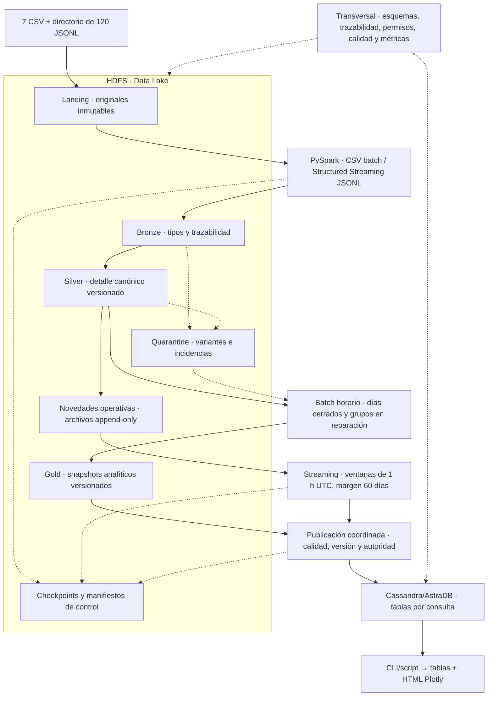

# Diseño de la primera entrega

Versión consolidada para revisión, 28/09/2026. Las decisiones D1–D16 están
aceptadas y sus alternativas se conservan en el [registro de decisiones](decisiones-de-diseno.md).
Este documento concreta esos acuerdos. Los mecanismos técnicos son propuestas
de diseño, no resultados probados. La evidencia reproducible de lectura y
perfilado sigue pendiente; la primera entrega todavía no está terminada.

## 1. Problema, usuarios y límite

El equipo de datos de un proveedor cloud necesita explicar cambios del costo
de uso a FinOps y ofrecer información de Soporte y Producto/Usage. El caso
principal compara organizaciones y servicios entre días UTC consecutivos,
mostrando ambos importes, diferencia en USD y porcentaje. Permite priorizar
por aumento absoluto o relativo. Facturación mensual y costo de uso son
conceptos distintos; no se concilian ni se infiere margen.

El consumo será un CLI/script que consulta Cassandra/AstraDB y genera tablas
y un reporte HTML con Plotly. FinOps consulta agregados entre organizaciones;
el responsable de datos investiga el detalle e incidencias. No se diseña
navegación por eventos individuales en la interfaz de consumo.

La entrega incluye diseño, inventario, perfilado inicial reproducible, matriz,
riesgos y plan. Quedan fuera la implementación integrada, cargas a Cassandra,
consultas analíticas ejecutadas, detector ejecutado, benchmarks y despliegue.
HDFS es el almacenamiento elegido; hosting, topología, instalación y Docker
Compose quedan diferidos. El pipeline futuro debe cumplir Colab o equivalente
validado; esa validación no se presume. [Alcance completo](alcance-primera-entrega.md).

| Resultado esperado | Criterio de aceptación del diseño |
| --- | --- |
| Comparación diaria confiable | Día D frente a D−1; ausencia y cero diferenciados; ambos rankings; calidad visible |
| Salida operativa | Organización-servicio-hora UTC; costo y consumo separado por métrica/unidad; actualización por lote |
| Frescura ordinaria | Objetivo de hasta 60 s desde entrada disponible hasta serving consultable; pendiente de medición |
| Correcciones | Batch cada hora, días cerrados afectados; también horas operativas en reparación, incluidas las del día actual |
| Excepción aceptada | Grupos horarios transferidos a batch esperan la corrida horaria más ejecución, también para novedades posteriores |
| Reproducción de esta entrega | Un comando de lectura/perfilado de las ocho fuentes, con versiones, conteos y salida verificable; pendiente |

El reporte HTML es una foto del corte consultado: generar otro reporte vuelve
a consultar. La frescura del serving no implica refresco automático del HTML.

## 2. Datos y escala

Fuentes sintéticas provistas por el campus. Los granos siguientes describen la
muestra; no prueban contratos universales de identidad o frecuencia. El
[inventario](../data/README.md) conserva conteos, hallazgos e instrucciones de acceso al
paquete. Ninguna inspección exploratoria se presenta como perfilado
reproducible terminado.

| Fuente | Filas | Grano / clave observada | Tipos y tiempo principales | Uso y riesgo |
| --- | ---: | --- | --- | --- |
| customers_orgs | 80 | Organización / org_id | IDs y categorías textuales, booleano, signup_date, NPS numérico | Dimensión de clientes; 11 NPS vacíos |
| users | 800 | Usuario / user_id | org_id, booleano active, created_at y last_login | Producto; 139 last_login vacíos; email restringido |
| resources | 400 | Recurso / resource_id | org_id, service, region, created_at, tags_json | Enriquecimiento; 83 tags vacíos; JSON a validar |
| support_tickets | 1.000 | Ticket / ticket_id | created_at, resolved_at, severity, csat, sla_breached | Soporte; 240 cierres y 254 CSAT vacíos |
| marketing_touches | 1.500 | Interacción / touch_id | timestamp, categorías, clicked y converted booleanos | Producto; actividad registrada, sin inferir causalidad |
| nps_surveys | 92 | Encuesta / organización-fecha observada | survey_date, NPS numérico, comment | Producto; 19 NPS y 10 comentarios vacíos; no hay survey_id |
| billing_monthly | 240 | Factura / invoice_id; una por org-mes | month, montos decimales, currency, exchange_rate_to_usd | Revenue; créditos vacíos, subtotales negativos y FX USD inconsistente |
| usage_events_stream | 43.200 | Evento / event_id | timestamp, IDs, metric, value, unit, costo, schema_version | Streaming; 120 JSONL, tipos ambiguos y validez por medida |

Los eventos abarcan 60 fechas de 2025, con 720 eventos diarios. Cada archivo
mezcla 59–60 fechas; no representa una partición temporal. Hay 43.200 IDs
únicos, 216 costos negativos y 2.906 eventos con consumo incompleto y costo
no negativo. V1 tiene 10.800 eventos; v2, 32.400, incorpora carbon_kg y, cuando
corresponde, genai_tokens. La muestra completa ocupa aproximadamente 13,3 MB
sin comprimir. Las fechas de las filas no establecen frecuencia de llegada.

Los CSV se diseñan como snapshots batch: maestros y actividad cuando haya
una nueva entrega, revisión prevista diaria; facturación por mes y sus
rectificaciones. Son supuestos operativos, no frecuencias medidas. Cada
snapshot conserva fecha de ingesta y versión. No se inventa historia SCD:
los atributos disponibles describen el snapshot usado, no necesariamente
el estado de la organización en la fecha histórica del evento.

| V | Aplicación y decisión |
| --- | --- |
| Volumen | La muestra no requiere un clúster por tamaño; HDFS/Spark responden al aprendizaje y a la arquitectura exigida. Como escenario de revisión, 1.000 veces los eventos implicaría 43,2 millones por 60 días, sin ser una previsión de negocio |
| Velocidad | Archivos para micro-lotes y CSV batch; separar frescura operativa, cadencia batch y tiempo de evento |
| Variedad | Siete CSV, JSONL v1/v2 y JSON anidado en tags; esquemas explícitos y contrato canónico |
| Veracidad | Nulos, tipos ambiguos, costos pendientes, conflictos y FX; calidad por medida y trazabilidad |
| Valor | Priorización FinOps con USD/%; SLA y CSAT de Soporte; uso, GenAI y contexto de Producto |

Con crecimiento se revisarán bytes leídos, estado, archivos pequeños y tiempos.
Multiplicar eventos no demuestra escalabilidad lineal ni rendimiento de HDFS.

## 3. Arquitectura lógica

Patrón híbrido: streaming para el operativo y batch para cálculo diario,
maestros, facturación y correcciones. Las lectures respaldan separar recorridos
según latencia, usar DataFrames/SQL y Parquet; no imponen desplegar HDFS ni
Colab para la evidencia mínima. [Fundamentos y páginas](referencia-lectures.md).



Las novedades operativas son una salida interna derivada, no una novena fuente
ni un broker. Evitan tratar los reemplazos de particiones Silver como nuevos
archivos de entrada streaming. Gold reúne FinOps, Soporte y Producto/Usage;
el modelo incluye la capacidad futura de anomalías requerida.

## 4. Contratos del Lake y promoción

Raíz lógica propuesta `/cloud_provider/`. Identificadores originales conservados;
nombres derivados en snake_case, fechas ISO y timestamps UTC. Parquet es el
formato intermedio; Landing mantiene CSV/JSONL originales. Rutas y metadatos
son contratos de diseño, no directorios ya desplegados.

| Zona / ruta relativa | Grano, partición y promoción |
| --- | --- |
| landing/<fuente>/ingest_date=.../<archivo> | Archivo original inmutable; registrar hash, tamaño, fecha y ruta de origen. Un archivo sólo se ofrece completo a la ingesta |
| bronze/<fuente>/ingest_date=.../batch_id=.../ | Fila/ocurrencia original con tipos explícitos, payload original y trazabilidad; nunca perder contradicciones por deduplicar primero |
| silver/usage_events/event_date=.../snapshot_id=.../ | Un evento lógico con validez por medida; partición UTC diaria, sin org/servicio en la ruta; un manifiesto selecciona la versión de cada día |
| silver/<csv>/snapshot_date=.../snapshot_id=.../ | Snapshot tipificado y validado; billing además por month cuando aporte poda. NPS sin clave contractual conserva referencia a fila original |
| quarantine/ingest_date=.../source=.../ | Registro o incidencia, causa, medida/grupos afectados, variantes y referencia al original; partitionar por ingesta permite registrar fechas de evento inválidas |
| gold/<mart>/period=.../publication_id=.../ | Resultado por grano de consulta, calidad y corte de datos; period diario o mensual; versiones inmutables |
| control/, checkpoints/, operational_changes/ | Manifiestos, progreso por query y archivos derivados de novedades; checkpoint distinto por query, sin usarlos como única copia histórica |

Bronze añade `ingest_ts`, `source_file`, `source_hash`, `batch_id`, referencia de
fila y versión del contrato. IDs/categorías usan texto; fechas y timestamps
tipos temporales; indicadores booleanos; montos y medidas decimales. Propuesta
numérica: decimal(38,12) y enteros de 64 bits para conteos, con rechazo explícito
de overflow o precisión no representable. Los campos ambiguos conservan el
valor crudo junto al parseado; un cast fallido produce incidencia, no cero.
Las precisiones y los rangos se contrastarán con el perfilado antes de implementar.

Silver normaliza texto y UTC, valida referencias y registra la versión de
maestros utilizada. Declara el superset v1/v2; campo no disponible en v1 se
mantiene ausente y se indica cobertura. No se infieren unidades por nombre ni
se convierten automáticamente métricas distintas. Tipo y unidad originales
permanecen trazables. Para identidad inválida o referencias no resolubles se
conserva el original y la incidencia sin asignar arbitrariamente un grupo.

La promoción requiere lectura correcta, esquema esperado, controles por medida
y manifiesto terminado. Una fila puede aportar costo aunque no aporte consumo.
Una suma sin contribuciones válidas se muestra sin valor, no como cero. Las
incidencias con grupo identificable afectan su calidad; las no asignables se
exponen como cobertura global pendiente.

Retención D3: conservar copias de trabajo durante proyecto y evaluación;
elegibles para limpieza 30 días después del cierre registrado. Preservar fuera
de esa limpieza originales, código, documentación y evidencia. Una tarea
aplicará la política a HDFS; se coordinará con serving y versiones referenciadas.
No borrar checkpoints activos ni datos de un reproceso en curso. El mecanismo
de ejecución queda diferido; el watermark no borra el Lake.

## 5. Transformaciones y reglas de negocio

### Identidad y calidad

Antes de descartar repeticiones se comparan variantes por event_id, excluyendo
metadatos de ingesta y considerando los casts y normalizaciones admitidos.
Una repetición equivalente cuenta una vez. Contradicciones sin revisión fiable
quedan como incidencia; schema_version, timestamp del evento e ingest_ts no
prueban qué contenido sustituye a otro. Si en el futuro la fuente aporta un
contrato de revisión ordenable, se podrá aplicar. Un empate contradictorio
continúa pendiente.

La validación contrasta también con el historial retenido, para detectar un ID
reaparecido en otro archivo o fecha. Para la muestra puede leerse el registro
canónico retenido; su costo debe medirse antes de extrapolar escala. El índice
lógico de identidad y su estado se reconstruyen desde los originales, no sólo
desde el estado temporal del streaming.

La validez se determina por medida. Costo negativo o contradictorio: pendiente,
excluido del total utilizable, con costo parcial y comparación fuera de rankings.
Costo alto válido: permanece. Consumo sin valor/unidad: no contribuye a esa
medida; no invalida costo utilizable. Campos GenAI/carbono se evalúan por separado.
Si cambia la identidad temporal o dimensional de un evento, los grupos anterior
y nuevo quedan afectados. No se asume una rectificación autorizada por llegar
más tarde.

### Métricas y salidas

| Medida / dominio | Regla propuesta sobre los datos disponibles |
| --- | --- |
| daily_cost_usd / costo horario | Sumar cost_usd_increment utilizable por org-servicio-período; guardar conteo válido y calidad |
| requests | Sumar value utilizable con metric=requests y unit=count |
| cpu_hours | Sumar value utilizable con metric=cpu_hours y unit=hours |
| storage_gb_hours | Sumar value utilizable con metric=storage_gb_hours y unit=gb_hours |
| GenAI | Sumar genai_tokens cuando exista; costo registrado de service=genai por separado, sin tarifa por token ni atribución exclusiva a tokens |
| Carbono | Sumar carbon_kg disponible y válido; ausencia en v1 no significa cero |
| Soporte | Fecha UTC de creación y severidad; conteo de tickets, tasa sla_breached=True sobre indicadores válidos, CSAT promedio válido y cobertura |
| Producto/contexto | Uso por org-servicio, recursos y usuarios por snapshot; interacciones clicked/converted y NPS por período con conteo válido. No se infiere que last_login vacío signifique nunca activo |
| Revenue mensual | D16: (subtotal − credits + taxes) × factor; USD factor 1 y FX inconsistente señalado, resto con FX positivo provisto |

Las tres métricas value/unit aparecen en los seis servicios observados:
compute, database, networking, analytics, genai y storage. El servicio no
sustituye el nombre de la métrica. genai_tokens es un campo adicional, no un
valor de metric. El costo GenAI mostrado incluye el costo registrado de sus
eventos; no afirma un costo puro de tokens.

Revenue conserva moneda, componentes y FX originales y aplicado. Créditos
vacíos o subtotales negativos quedan pendientes; no se imputan ceros. Una
factura no calculable deja org-mes sin importe. Una suma que excluye facturas
pendientes se identifica como parcial. El supuesto de fórmula fue aceptado,
no validado como contrato contable de la fuente.

FinOps calcula delta_usd = costo_D − costo_D−1 y porcentaje relativo a D−1.
Sin registros previos o costo previo cero: sin base comparable, sin porcentaje
ni ranking porcentual. Si falta un importe tampoco se fabrica delta absoluto;
un cero real sí permite delta USD. Se excluyen comparaciones con costos
parciales. El rango de fechas incluye ambos días calendario requeridos.

El mart futuro de anomalías conserva org-fecha-servicio, flag/score y contexto,
como exige §4.4/§7.3. Método candidato: umbral por percentil del histórico
comparable del grupo, para evitar una suposición de normalidad. La ventana,
mínimo de observaciones y percentil quedan por calibrar con datos suficientes;
sin base se indicará no evaluable. Esa selección sigue abierta en el plan
posterior. Las variaciones o defectos de calidad no son automáticamente una
anomalía de costo. No se ejecuta el detector en esta entrega.

## 6. Recorridos de procesamiento

### Streaming y recuperación

1. Un script de reproducción ofrecería copias de los JSONL originales completos
   al directorio de entrada. No reordena eventos ni modifica Landing. La tasa
   de presentación y los archivos por lote serán parámetros documentados; el
   objetivo de frescura se mide desde esa disponibilidad, no desde la fecha 2025.
2. Ingesta con readStream y esquema explícito; foreachBatch conserva Bronze,
   clasifica calidad/conflictos y publica un nuevo manifiesto Silver con sus
   incidencias. Un cambio que necesita reparación bloquea la autoridad streaming
   del grupo antes de permitir otra publicación. Una caída se recupera por ID
   de query, lote y archivos, sin duplicar la contribución.
3. Sólo se emiten como novedades operativas nuevas contribuciones canónicas.
   Una query separada deduplica por event_id con watermark de 60 días; se prevé
   dropDuplicatesWithinWatermark, sujeto a compatibilidad del runtime. Su salida
   es append a Parquet. Conflictos y eventos fuera de margen quedan preservados
   antes de este operador y registrados para recuperación.
4. Otra query agrega esas novedades por org-servicio-ventana de una hora UTC,
   con watermark de 60 días y salida Update mediante foreachBatch al publicador.
   Se usan checkpoints distintos. Separar deduplicación y agregación evita
   depender de una cadena de operadores con estado no admitida en Update.
5. El publicador verifica autoridad y generación del grupo. Los grupos
   transferidos por D12 se reconstruyen sólo en el batch horario desde Silver,
   incluidas nuevas contribuciones válidas. No se devuelve autoridad a un
   acumulador que no haya sido reconciliado.

Antes de promover Silver, cada lote guarda un plan recuperable con su corte,
archivos, variantes, invalidaciones y todas las salidas esperadas. El reintento
completa salidas faltantes desde ese plan aunque sus IDs ya figuren en Silver.
Así, una caída entre actualizar Silver y emitir novedades no pierde eventos
operativos. El lote no se considera terminado hasta verificar sus salidas.
Para esta muestra, la ingesta publica un archivo de novedades por lote: lo
escribe y cierra fuera del directorio observado y lo promueve completo con
nombre determinista. Si ya existe, verifica el contenido lógico esperado.
Se usará rename dentro del mismo HDFS y límites compatibles, comprobando el
resultado; esto no se generaliza a otros backends. [Contrato de filesystem](https://apache.github.io/hadoop/hadoop-project-dist/hadoop-common/filesystem/filesystem.html).

Propuesta inicial de triggers: 10 s por query. Presupuesto ilustrativo extremo:
hasta 30 s de espera entre tres etapas y 30 s para lectura, validación,
procesamiento y publicación. Es un presupuesto a comprobar, no una medición
ni un SLA garantizado. Si hay backlog, se expone y se revisan tamaños de lote,
paralelismo y costo de identidad antes de declarar alcanzado el objetivo.

El margen de 60 días cubre el intervalo de la muestra si no se mezclan eventos
posteriores ajenos a ella. No garantiza una configuración eficiente a escala.
Se publican resultados provisionales sin esperar cierre de ventanas. Una
entrada finita no hace avanzar por sí sola el watermark hasta cerrarlas todas.
La recuperación identifica todas las horas fuera del margen garantizado,
aunque Spark hubiera incorporado algunas: reemplazar desde detalle evita
sumarlas otra vez. Esta reparación no depende de inferir un descarte exacto.

Las garantías de operadores y limitaciones de consultas están documentadas por
[Spark](https://spark.apache.org/docs/latest/streaming/apis-on-dataframes-and-datasets.html).
foreachBatch puede reintentarse; la aplicación debe hacer sus escrituras
idempotentes. Los archivos de novedades, snapshots y manifiestos comprometidos
son inmutables. Repetir un lote verifica/reutiliza su salida; cambios después
de su corte forman otro lote. La compatibilidad de APIs, checkpoints y driver
queda por validar al fijar versiones, no se atribuye exactly-once al pipeline
por usar Spark.

### Batch horario y cálculo diario

Cada hora se fija un manifiesto de Silver, incidencias y snapshots CSV.
Se reúnen los días cerrados nuevos o modificados y los grupos horarios bajo
autoridad batch. Cada día afectado se reconstruye una vez; el día actual sólo
se procesa para sus horas operativas. Las novedades posteriores al corte
quedan pendientes y no se borran al completar la corrida anterior.

Además de D y sus comparaciones D/D−1 y D+1/D, una modificación de D invalida
los acumulados de 14 días cuyo intervalo incluya D. No hace falta recalcular
el detalle de esos otros días: se usan sus agregados con versiones coherentes.
Facturas, tickets y demás CSV se recalculan cuando cambie su snapshot. Un
cambio de dimensión que afecte la interpretación de datos ya publicados marca
los períodos impactados; no se mezcla silenciosamente una dimensión nueva
con resultados de la anterior.

Equivalente conceptual MapReduce, sin implementar otro motor:

```text
Map: proyectar evento canónico e incidencias
     clave = (org_id, service, fecha UTC)
     valor = contribuciones válidas por medida + conteos de calidad
Shuffle: reunir valores con la misma clave
Reduce: sumar importes/consumos y conteos; derivar parcialidad/cobertura
Después: unir D con D−1, calcular USD/%, ordenar rankings elegibles
```

La implementación prevista usa DataFrames/SQL. El reduce no convierte una
unidad ausente ni una medida sin contribuciones válidas en cero. La alternativa
de recalcular sólo grupos o aplicar deltas se revisará si se acumula trabajo o
se supera el presupuesto, según el [análisis de D6](decisiones-de-diseno.md).

## 7. Publicación coherente y fallos

Contrato técnico propuesto para cumplir D12/D15:

- Cada resultado lleva source_cut, publication_id, schema_version, estado de
  calidad y generated_at. generated_at no decide autoridad sobre otro escritor.
- Batch produce una versión completa de los agregados que el CLI consultará
  juntos. Puede reutilizar agregados no modificados al materializarla, sin
  releer detalle que no cambió. Se escriben Gold y las filas de serving bajo
  un nuevo publication_id; se verifican conteos y luego se activa su referencia.
- El CLI fija una publicación batch al iniciar la consulta/reporte. Todas sus
  tablas, comparaciones y rankings usan ese ID. Filas omitidas en la nueva
  versión no sobreviven accidentalmente como restos de la anterior.
- Para el operativo, cada grupo horario publica un conjunto de medidas bajo
  un ID inmutable. Su referencia de control contiene autoridad stream/batch,
  generación y estado. Un conflicto incrementa la generación y cambia la
  autoridad a batch antes de autorizar una reparación. La activación de una
  salida comprueba autoridad/generación y el predecesor esperado.
- Toda activación, también batch, exige que la referencia activa siga siendo
  el predecesor contra el que se calculó y que el corte no retroceda en ninguna
  entrada relevante. Se comprueban snapshots/progreso, no hora de escritura.
  Si otra publicación ganó, se rechaza el candidato o se recalcula; no se
  reintenta el CAS ignorando la nueva base. Si el mismo ID ya está activo,
  el reintento sólo verifica su finalización. Esto evita retrocesos dentro
  de una misma autoridad y generación.
- Un mismo responsable lógico de publicación aplica esas reglas. El mecanismo
  previsto usa filas de control con actualización condicional, no un nuevo
  servicio. Los cálculos pueden escribir candidatos; sólo el control autoriza
  hacerlos visibles. Los candidatos rechazados quedan sin referencia activa.
- Fallo antes de activar: sigue la publicación anterior, señalada como pendiente
  o fallida. No se la considera confiable si ya hay incidencias conocidas.
  Estas se consultan junto a la versión y excluyen de rankings los grupos
  afectados; si no se puede comprobar su estado, la consulta lo informa y no
  los presenta como elegibles. Sin publicación anterior: no disponible.

El estado de calidad se publica también como agregado por grupo/período, con
revisión, elegibilidad y actualización pendiente. No expone variantes ni PII.
El CLI fija su revisión además del publication_id y verifica al finalizar que
no haya cambiado; si cambió, rehace la evaluación o declara que no pudo obtener
una vista estable, sin presentar un ranking como vigente. Las correcciones no
borran incidencias ni pendientes posteriores a su corte. Quarantine continúa
restringida al responsable de datos.

Las actualizaciones condicionales de Cassandra permiten compare-and-set en
una partición; no convierten una carga de varias tablas en una transacción
aislada global. Por eso se proponen datos versionados más referencia activa.
Se deben validar niveles de lectura/escritura compatibles antes de activar
referencias, junto con conteos y cobertura. [Semántica CQL](https://cassandra.apache.org/doc/stable/cassandra/developing/cql/dml.html).

Batch y operativo tienen cortes distintos, explícitos en el reporte. En el
operativo, la coherencia se garantiza por grupo horario; no se promete que
todas las horas cambien simultáneamente. Calidad y estado de actualización
son ejes distintos: una publicación terminada puede contener un total parcial.
La retención conserva las versiones activas y las que estén siendo leídas o
reprocesadas. Tras cierre y margen D3 se coordina limpieza de Lake y serving.

## 8. Serving y consumo

Las siguientes claves son propuestas query-first; `pub` es la publicación
batch fijada por el consumidor. Cada período temporal de la clave se deriva
de la fecha consultada. Rangos que atraviesan meses/años se dividen en consultas
acotadas. Las agregaciones analíticas se preparan en Spark; el CLI no necesita
un join o escaneo global de Cassandra. El modelo sigue la orientación por
consulta de [Cassandra](https://cassandra.apache.org/doc/stable/cassandra/developing/data-modeling/intro.html).

| Tabla propuesta | Partition key | Clustering / orden | Consulta y contenido |
| --- | --- | --- | --- |
| org_daily_usage_by_service | org_id, service, month, pub | usage_date ASC | Costo, requests, cpu_hours, storage_gb_hours, carbono y calidad diarios; enumerar servicios para una vista conjunta |
| top_services_14d | org_id, reference_date, pub | rank ASC, service | Top-N por costo acumulado de los 14 días calendario terminados en reference_date; importe, cobertura y elegibilidad |
| tickets_by_org_date | org_id, severity, month, pub | date ASC | Conteos, breached_count, indicador válido, tasa y CSAT; critical y rango de 30 días |
| revenue_by_org_month | org_id, year, pub | month ASC | Importe USD o no calculable, componentes, FX original/aplicado e incidencias |
| genai_tokens_by_org_date | org_id, month, pub | date ASC | Tokens disponibles, costo registrado GenAI y cobertura de cada medida |
| finops_daily_comparison | org_id, service, month, pub | date ASC | D/D−1, delta USD, porcentaje, base comparable y calidad |
| finops_ranking_by_date | date, ranking_type, pub | rank ASC, org_id, service | Priorización entre organizaciones, por aumento USD o relativo; sólo comparaciones elegibles |
| cost_anomaly_mart, futuro | org_id, service, month, pub | date ASC | Flag/score, método y contexto; no evaluable hasta definir método y base suficientes |
| hourly_head_by_org_day | org_id, date | hour ASC, service | Referencia activa por grupo, autoridad, generación, estado y corte |
| hourly_usage_version | org_id, service, hour, version | metric, unit | Medidas de la versión horaria y su calidad; se consulta la versión resuelta por head |
| publication_head | dataset_id | — | Publicación batch activa, corte, estado y generación; actualizaciones condicionales |
| quality_status_by_period | domain, period, quality_revision | org_id, service, hour_scope, measure | Estado agregado, elegibilidad, motivos resumidos y recálculo pendiente; sin variantes originales |
| quality_head | dataset_id | — | Revisión de calidad activa que el reporte fija y vuelve a verificar |

El rango de N se limita a servicios disponibles. Fecha de referencia, org_id,
servicio y N son parámetros del CLI. Para una ventana de 14 días, se consideran
reference_date−13 a reference_date, sin sustituir días sin actividad por otros
más antiguos. La ausencia de registros se refleja en cobertura; no se afirma
consumo cero ni cobertura total del proveedor. Rankings excluyen importes
parciales o disputados. Empates usan servicio/organización como orden estable.

El consumo operativo lee las referencias de las horas pedidas y luego sus
versiones inmutables. Esa lectura adicional permite conservar el valor anterior
mientras se publica el siguiente. Las incidencias actuales se verifican antes
de presentar elegibilidad. Las tablas analíticas se separan de las de control;
los usuarios de consumo no escriben ninguna de ellas.

Salida prevista del CLI: tablas reproducibles y HTML con costo diario y sus
variaciones, top-N 14 días, evolución de tickets/SLA, revenue y GenAI. El reporte
explica fecha/corte, estado y cobertura; no muestra PII de usuarios ni texto libre.
Una ejecución futura puede exportar resultados para acreditar las consultas
§7.4. CLI/script y Plotly están elegidos; nombres de comandos y versiones se
fijarán al implementar. [Exportación HTML de Plotly](https://plotly.com/python/interactive-html-export/).

## 9. Gobierno, calidad y observabilidad

Un único integrante asume análisis, ingeniería y revisión; los roles siguientes
son responsabilidades lógicas. Consumidor: lectura de marts/reportes. Responsable
de datos: detalle, incidencias, promoción y resolución respaldada por fuente.
Proceso de publicación: escritura de versiones y control. No se agrega login
ni se despliega un proveedor de identidad en esta entrega.

Los esquemas, diccionario de métricas, reglas y manifiestos se versionan con el
código. El manifiesto registra hashes de entrada, query/lote, contrato, revisión
de código, snapshots de dimensiones, fechas, conteos y estado. Cambiar una regla
requiere nueva versión y reproceso trazable, no editar silenciosamente un total.

Emails, responsables comerciales y comentarios se conservan sólo donde sean
necesarios y con acceso restringido; los marts propuestos usan agregados e IDs
organizacionales. Evidencia y logs omiten credenciales y contenido personal.
Conexiones futuras usarán credenciales externas al repositorio y permisos
mínimos; controles de acceso y transporte se concretarán al elegir entorno.

Métricas previstas: filas leídas, canónicas, repetidas, conflictivas y excluidas
por medida; referencias inválidas; cobertura v1/v2; ingest_lag, duración y backlog;
watermark observado, estado y checkpoints; días/grupos pendientes de reparación;
filas esperadas/publicadas y fallos de activación. La latencia operativa se mide
de entrada disponible a versión consultable, y la de reparación por separado.
Una corrida fallida conserva trazabilidad y permite reintento idempotente; un
alertado o umbral de escalamiento concreto se valida después, sin añadir una
plataforma de observabilidad en esta entrega.

## 10. Matriz de requisitos y riesgos

| Consigna / necesidad | Decisión y componente | Comprobación prevista |
| --- | --- | --- |
| §§2.1–2.3, usuarios y valor | FinOps principal; Soporte y Producto/Usage; secciones 1 y 5 | Preguntas, fórmulas y calidad diferenciadas; no conciliar eventos/facturas |
| §5.2, 5V y viabilidad | Escala observada y escenario explícito; sección 2 | Conteos/bytes reproducibles y supuestos sin promesas de escala |
| §4.2, Lake | HDFS, zonas, Parquet y manifiestos; D3–D5 | Contratos, promoción, particiones, metadatos y retención documentados |
| §§4.3–4.4, streaming/batch | Tres etapas streaming y batch horario; D1, D7–D12 | Esquema, watermark, dedup, checkpoint, cortes y recuperación descritos |
| §4.4, calidad | D2/D9/D16 y quarantine | Ejemplos de validez por medida, conflictos y moneda; originales preservados |
| §4.4, features y anomalías | Tabla de medidas y mart futuro | Features mapeadas; método candidato de anomalías y calibración abierta visibles |
| §5.2.9, batch conceptual | Map → shuffle → reduce y comparación posterior | Correspondencia con claves, contribuciones y reglas FinOps |
| §§7.3–7.4, serving | Tablas por consulta y control de versiones | Cinco consultas obligatorias cubiertas, además de las salidas FinOps/operativa |
| §§2.2, 5.2.8, consumo | CLI + HTML, D13/D14 | Herramientas nombradas y recorrido hasta resultados; hosting pendiente |
| §8.2, reproducibilidad/seguridad | Versiones, hashes, roles y comandos | Evidencia versionada y reproducción desde entorno limpio, todavía pendientes |
| §§5.2.10–12, plan | Riesgos, recursos y tareas de cierre | Responsables, esfuerzo, validación y decisiones diferidas |

| Riesgo | Mitigación / límite |
| --- | --- |
| Estado de 60 días y archivos pequeños | Configuración acotada a la muestra; medir estado, latencia y número de archivos; compactar sólo versiones no observadas por queries activas |
| Conflictos ocultos o doble contribución | Conservar variantes antes de dedup, contraste con historial y escrituras idempotentes |
| Streaming revive un total corregido | Autoridad batch por grupo reparado y generaciones verificadas al activar |
| Datos nuevos durante una corrida o caída a mitad de carga | Corte inmutable, pendientes posteriores conservados, publicación versionada y referencia activa |
| Query/ranking con días o versiones mezcladas | Fijar pub batch; recalcular comparaciones dependientes y ventanas 14 días afectadas |
| Interpretación contable no confirmada | D16 explícita, originales/FX preservados, importes no calculables y cobertura |
| Maestros sin historia y fuentes incompletas | Versión del snapshot visible; no inferir SCD ni ausencia=0; incidencias y supuestos documentados |
| Particiones o snapshots excesivos al crecer | Mes/año en claves, límites de consulta; medir tamaños antes de extrapolar el modelo académico |
| API/driver o consistencia incompatibles con entorno | Fijar versiones y comprobar checkpoint, LWT y lectura/escritura; no declarar garantías integradas sin prueba |
| Entorno alternativo no validado | Mantenerlo como decisión abierta con condición docente de §2.2; no desplegar para esta entrega |
| Un solo responsable y evidencia aún pendiente | Priorizar perfilado mínimo y reproducción sobre nuevas interfaces o infraestructura |

## 11. Plan de cierre y validación

Estimación del trabajo restante de primera entrega, no tiempos medidos ni
compromiso de fecha. Responsable de todas las tareas: autor del proyecto.

| Tarea restante | Esfuerzo estimado | Resultado |
| --- | --- | --- |
| Revisar este diseño y corregir inconsistencias | 1–2 h | Documento y matriz acordados |
| Script de inventario/perfilado de ocho fuentes | 3–5 h | Grano, tipos, nulos, claves, relaciones, fechas y calidad regenerables |
| Evidencia y README de reproducción | 1–2 h | Comando, versión de Python, entradas/hashes, conteos y salida sin PII |
| Verificación desde entorno limpio y revisión de entrega | 1–2 h | Checklist y límites de evidencia confirmados |
| Total preliminar | 6–11 h | Diseño y evidencia mínima, sin pipeline integrado |

Para la evidencia, propuesta de recursos: Python 3 y biblioteca estándar en
un equipo local; referencia de planificación de 2 CPU lógicas, 4 GB RAM y
200 MB libres para datos/resultados, además del entorno ya instalado. Se
leerán archivos por filas; la muestra inicial ocupa unos 13,3 MB. Estos recursos
no dimensionan HDFS/Spark/Cassandra ni su despliegue. El almacenamiento futuro
se estimará con bytes por capa, versiones retenidas, réplicas y checkpoints;
la compresión y memoria del estado requieren medición posterior.

Validación ejecutable de esta entrega, aún pendiente:

- Inventariar las ocho fuentes y los 120 JSONL; registrar hashes y tamaños,
  leer todos los registros y reportar errores sin modificar originales.
- Verificar grano, esquema y casts, IDs, duplicados y referencias; conteos por
  fecha, versión, servicio y moneda; nulos y validez por medida.
- Reproducir, entre otros hallazgos, 43.200 eventos/IDs, 60 fechas, 216 costos
  negativos, 137 créditos vacíos y FX USD inconsistente. Divergencias se
  investigan; estos conteos no se usan para ocultar nuevos defectos.
- Conservar instrucciones y salida sin PII en evidence/ cuando existan. La
  ubicación local de Downloads no será una dependencia fija del script.

Validación del pipeline posterior, sólo planificada: reintento del mismo lote;
ID idéntico y contradictorio; consumo inválido con costo válido; cero frente a
fecha ausente; corrección D y D+1 y top-N 14 días; publicación interrumpida;
reparación seguida de escritura streaming obsoleta; conflictos de FX y cobertura;
coincidencia de alternativas con recálculo completo. Medir frescura ordinaria
y reparación por separado. No se escriben esas pruebas ni se ejecutan marts ahora.

Quedan abiertas deliberadamente la validación del entorno equivalente,
versiones de runtime/driver, hosting y topología, scheduler y despliegue, y la
calibración del detector futuro. Los mecanismos técnicos aquí propuestos se
revisarán antes de implementar; las decisiones de negocio D1–D16 no se reabren
por esos detalles salvo incompatibilidad demostrada.

## Fuentes

- Consigna v1.0, §§2–5, 7–9; archivos y README del dataset del campus.
- [Lectures y páginas por fundamento](referencia-lectures.md).
- [Inventario y comprobaciones exploratorias](../data/README.md).
- [Decisiones D1–D16 y alternativas](decisiones-de-diseno.md).
- Documentación oficial de Spark, Cassandra y Plotly enlazada junto a cada uso.
  Consultada el 28/09/2026; no equivale a fijar las versiones del proyecto.
