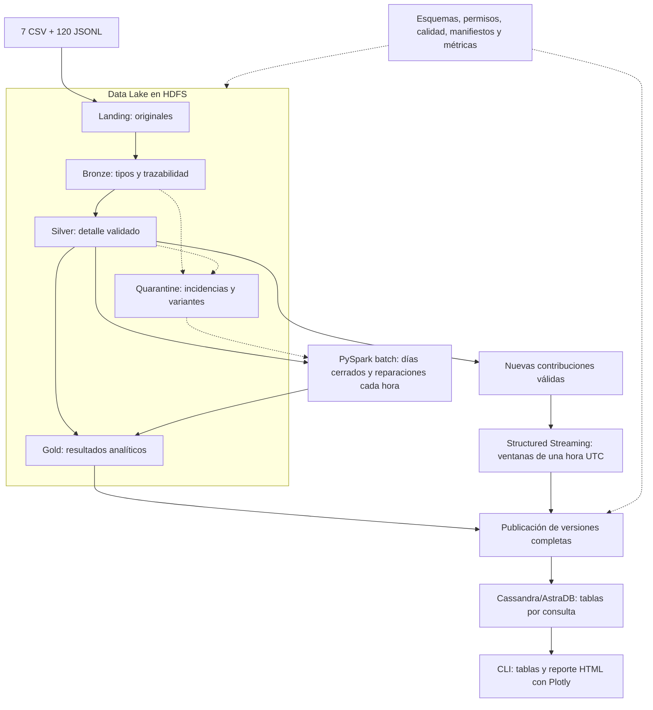

# Cloud Provider Analytics

## Problema y objetivos

Un proveedor cloud necesita entender cómo cambia el consumo de sus clientes
y qué explica los aumentos de costo. FinOps es el usuario principal: debe
poder revisar una organización y servicio, comparar días consecutivos y
priorizar tanto aumentos porcentuales como diferencias en dólares. Soporte
necesita seguir tickets críticos e incumplimientos de SLA; Producto, analizar
uso de servicios y GenAI.

El costo registrado en los eventos y el ingreso por facturación son medidas
distintas. Se analizarán por separado, sin asumir que deben coincidir ni
calcular un margen a partir de ellas.

En esta entrega diseñamos el recorrido de los CSV y JSONL desde Landing hasta
las consultas. Elegimos HDFS y Parquet para el almacenamiento, PySpark para
procesar los datos y Cassandra/AstraDB para servir resultados. El CLI mostrará
tablas y un reporte HTML con Plotly. La ejecución completa del pipeline queda
para las próximas entregas.

| Objetivo | Criterio de evaluación |
| --- | --- |
| Explicar aumentos de costo | Comparar días UTC consecutivos por organización y servicio, mostrando ambos costos, diferencia en USD y porcentaje |
| Priorizar casos para FinOps | Permitir ordenar por aumento absoluto o relativo y excluir comparaciones con costos parciales |
| Consultar consumo operativo | Agregar por organización, servicio y hora UTC, separando métrica y unidad |
| Actualizar el operativo | Objetivo de hasta 60 segundos desde que el archivo está disponible hasta que el resultado puede consultarse |
| Corregir resultados históricos | Recalcular cada hora los períodos afectados y mostrar fecha, cobertura y estado de actualización |

El objetivo de 60 segundos debe validarse con mediciones. Los grupos que
necesiten reparación pasarán al batch horario, también para sus novedades
posteriores, y esperarán el siguiente corte más su tiempo de procesamiento.
El reporte HTML representa el corte consultado; para actualizarlo se ejecuta
de nuevo el CLI.

## Datos y exploración inicial

El paquete sintético `cloud_provider_challenge_dataset_v1`, disponible en el
campus, contiene siete CSV y 120 archivos JSONL dentro de `datalake/landing/`.
Se leyeron los CSV y cada línea JSON sin modificar los originales. Los conteos
siguientes provienen de esa inspección; falta incorporar el script y su salida
para que la exploración pueda reproducirse desde el repositorio.

| Fuente | Registros | Grano y clave observada | Campos principales y calidad |
| --- | ---: | --- | --- |
| customers_orgs.csv | 80 | Organización, org_id | Categorías, plan, signup_date y NPS; 11 NPS vacíos |
| users.csv | 800 | Usuario, user_id | org_id, active, created_at, last_login y email; 139 last_login vacíos |
| resources.csv | 400 | Recurso, resource_id | Organización, servicio, región, estado y tags_json; 83 tags vacíos |
| support_tickets.csv | 1.000 | Ticket, ticket_id | Severidad, fechas, sla_breached y CSAT; 240 cierres y 254 CSAT vacíos |
| marketing_touches.csv | 1.500 | Interacción, touch_id | Organización, campaña, canal, timestamp, clicked y converted |
| nps_surveys.csv | 92 | Encuesta por organización y fecha | NPS y comentario; 19 NPS y 10 comentarios vacíos, sin survey_id |
| billing_monthly.csv | 240 | Factura, invoice_id; una por organización-mes | Montos, moneda y tipo de cambio; 137 créditos vacíos y 13 subtotales negativos |
| usage_events_stream/*.jsonl | 43.200 | Evento, event_id | Timestamp, organización, recurso, servicio, métrica, valor, unidad, costo y versión de esquema |

La muestra ocupa aproximadamente 13,3 MB sin comprimir. Los eventos van del
03/07/2025 a las 00:02 al 31/08/2025 a las 23:58 UTC, con 720 eventos por día.
Cada archivo mezcla 59 o 60 fechas, por lo que el orden de los archivos no
representa el orden temporal de los eventos. La facturación cubre junio,
julio y agosto de 2025.

Los 43.200 identificadores de evento son únicos. Todas las referencias a
organizaciones y recursos existen, y sus asociaciones de organización,
servicio y región coinciden. Hay 216 costos negativos, 877 valores de consumo
nulos, 1.309 valores como texto numérico y 2.075 unidades ausentes. En 2.906
eventos el consumo está incompleto pero el costo es no negativo: descartar
la fila entera también eliminaría costos utilizables.

La versión v1 aporta 10.800 eventos y v2, 32.400. Todos los v2 incluyen
`carbon_kg`; 3.132 incluyen `genai_tokens`. Las versiones representan cambios
de esquema, no revisiones de un mismo evento. De 262 combinaciones de
organización y servicio, 259 tienen algún día sin registros. Esa ausencia
no demuestra consumo cero.

En facturación hay 160 filas USD, 51 ARS y 29 EUR. Todos los tipos de cambio
son positivos, pero los 160 correspondientes a USD difieren de 1. El paquete
no aclara si un crédito vacío significa cero ni si un subtotal negativo es
un ajuste. Estas ambigüedades requieren reglas de calidad explícitas.

Los CSV se tratarán como snapshots: revisión diaria de nuevas entregas de
maestros y actividad, y facturación mensual con posibles rectificaciones.
Es una frecuencia propuesta; las fechas de las filas no prueban la frecuencia
de llegada. Los atributos de los maestros describen su snapshot, sin asumir
que representan el estado histórico de cada cliente.

### Las 5V en este caso

| Dimensión | Implicación para el diseño |
| --- | --- |
| Volumen | La muestra cabe en un equipo local. Spark y HDFS permiten estudiar el procesamiento distribuido; como escenario de crecimiento, 1.000 veces los eventos daría 43,2 millones en 60 días |
| Velocidad | Separar la actualización operativa por micro-lotes del análisis diario y las correcciones batch |
| Variedad | Integrar CSV, JSONL v1/v2 y JSON anidado en tags con esquemas explícitos |
| Veracidad | Conservar nulos, conflictos, tipos ambiguos y problemas de moneda con trazabilidad y calidad por medida |
| Valor | Explicar variaciones de costo, priorizar su revisión y relacionar consumo con información de Soporte y Producto |


## Arquitectura

Se propone un patrón híbrido. Structured Streaming procesa los eventos para
el operativo; el batch incorpora CSV, calcula resultados diarios y corrige
períodos anteriores. Ambos usan el detalle validado del Lake. Así, una
corrección histórica no depende de conservar todo el estado del streaming.



Usaremos Parquet en las capas transformadas porque las consultas leen columnas
y períodos concretos. PySpark calculará los agregados y Cassandra guardará
tablas preparadas para esas consultas. Las novedades operativas viajarán en
archivos derivados internos. Todavía falta validar las versiones y el entorno
de ejecución.

## Organización del Data Lake

Las rutas parten de `/cloud_provider/`. Se conservan los identificadores de
origen, se usan nombres derivados en snake_case y se normalizan tiempos a UTC.
Landing guarda CSV/JSONL; las capas de transformación usan Parquet.

| Zona y partición | Contenido y condición de promoción |
| --- | --- |
| `landing/<fuente>/ingest_date=.../` | Archivos originales completos e inmutables, con ruta, tamaño y hash |
| `bronze/<fuente>/ingest_date=.../batch_id=.../` | Grano original, esquema explícito y valores crudos junto a los interpretados; añade ingest_ts y source_file |
| `silver/usage_events/event_date=.../snapshot_id=.../` | Eventos normalizados, referencias verificadas y validez por medida; un manifiesto selecciona la versión vigente de cada día |
| `silver/<csv>/snapshot_date=.../snapshot_id=.../` | Maestros y otras fuentes tipificados y versionados; facturación puede subdividirse por mes |
| `quarantine/ingest_date=.../source=.../` | Errores, variantes contradictorias y medidas pendientes, vinculados al original y a los grupos afectados |
| `gold/<mart>/period=.../publication_id=.../` | Agregados de FinOps, Soporte y Producto con cobertura y corte de datos; período diario o mensual |
| control/ y checkpoints/ | Manifiestos, progreso y checkpoint independiente por consulta |

Particionar eventos Silver sólo por fecha permite reconstruir días sin crear
numerosos archivos por organización y servicio. Con 720 eventos diarios,
agregar esas divisiones fragmentaría demasiado los datos. Los snapshots
versionados permiten leer un corte estable mientras se prepara otro.

Antes de pasar eventos a Silver comprobaremos el identificador, la fecha, las
referencias a organización y recurso, y la validez de costo y consumo por
separado. Guardaremos las filas con problemas junto con el archivo y la regla
que los detectó. Un manifiesto identificará las salidas de cada promoción.

Las copias de trabajo se conservarán durante el proyecto y su evaluación.
Serán elegibles para limpieza automática 30 días después del cierre registrado.
Originales, código, documentación y evidencia se archivarán por separado.
La limpieza de HDFS y Cassandra deberá proteger versiones en uso, checkpoints
y reprocesamientos activos. El watermark limita estado de procesamiento;
no determina la retención del Lake.

## Reglas de calidad y cálculo

La validez se evalúa por medida. Un evento puede aportar costo aunque falten
valor o unidad de consumo. Los costos negativos quedan pendientes de
validación, separados del total utilizable; los costos altos válidos se
conservan. Un total es parcial si excluye contribuciones pendientes. Una suma
sin valores utilizables se muestra sin importe, nunca como cero.

Antes de deduplicar por `event_id` se comparan sus variantes, también contra
el historial retenido. Repeticiones equivalentes cuentan una vez. Si hay
contenidos contradictorios, se conserva la incidencia y se excluye la
contribución disputada. Ni la llegada más reciente ni `schema_version`
identifican una corrección autorizada. Un desempate necesitaría una secuencia
de revisión garantizada por la fuente, que este paquete no ofrece.

| Medida | Cálculo |
| --- | --- |
| Costo diario u horario | Suma de cost_usd_increment utilizable por organización, servicio y período UTC |
| Requests | Suma de value con metric=requests y unit=count |
| CPU | Suma de value con metric=cpu_hours y unit=hours |
| Almacenamiento | Suma de value con metric=storage_gb_hours y unit=gb_hours |
| GenAI | Suma de genai_tokens disponibles y costo de service=genai por separado; no se infiere una tarifa por token |
| Carbono | Suma de carbon_kg válido, con cobertura; su ausencia en v1 no equivale a cero |
| Soporte | Tickets por fecha de creación y severidad; tasa sla_breached sobre indicadores válidos y CSAT promedio con cobertura |
| Producto | Uso por servicio, recursos y usuarios por snapshot, interacciones clicked/converted y NPS por período |
| Revenue mensual | (subtotal − credits + taxes) × factor de conversión a USD |

Las métricas de consumo se separan por nombre y unidad, independientemente del
servicio. No se deduce una unidad ausente ni se suman unidades incompatibles.

FinOps compara el día D con D−1. La diferencia absoluta es `costo_D − costo_D−1`
y la relativa es esa diferencia dividida por `costo_D−1`, multiplicada por 100.
Si no hay registros previos o su costo es cero, el caso queda sin base
porcentual. Un cero real permite calcular diferencia absoluta; un importe
ausente, no. Las comparaciones con costos parciales quedan fuera de ambos
rankings. No se reemplaza el día anterior por la última fecha con actividad.

Para revenue, USD usa factor 1 y registra la inconsistencia del FX original;
las demás monedas usan el factor positivo provisto. Se conservan moneda,
componentes y tipos de cambio original y aplicado. Créditos vacíos y subtotales
negativos quedan pendientes. Si la única factura de una organización-mes no
es calculable, su importe queda ausente; una suma que la excluya es parcial.
La fórmula es una convención del proyecto, no una regla contable confirmada
por el README del paquete.

El mart de anomalías incluirá organización, servicio, fecha, flag o score y
contexto. Se evaluará un umbral por percentil del histórico comparable, sin
suponer normalidad. Ventana, percentil y mínimo de observaciones requieren
calibración; sin base suficiente se mostrará no evaluable. Un aumento o una
incidencia de calidad no constituyen por sí solos una anomalía de costo.

## Procesamiento y correcciones

### Streaming

Un script presentará archivos JSONL completos al directorio de entrada, a una
tasa configurable. La ingesta usará esquema explícito, conservará Bronze y
validará Silver antes de emitir nuevas contribuciones operativas. Los
conflictos se detectan antes de cualquier descarte por duplicación o tardanza.

Se separan tres consultas con checkpoints propios: ingesta y validación,
deduplicación con watermark, y agregación por ventanas horarias. Las dos
últimas se conectan mediante archivos Parquet añadidos de forma inmutable;
no se observan como entradas nuevas las particiones Silver reemplazadas.
La agregación publica resultados provisionales por micro-lote.

El watermark de 60 días cubre el desorden de esta muestra, cuyo intervalo es
de 59 días, 23 horas y 56 minutos, siempre que no se mezclen timestamps
posteriores ajenos a ella. Evita preparar un replay ordenado, a cambio de
conservar más estado. Un margen corto reduciría ese estado y aumentaría la
recuperación batch. Su costo se medirá antes de extrapolarlo a otra escala.

Como punto de partida se proponen triggers de 10 segundos por consulta:
hasta 30 segundos de espera entre etapas y otros 30 para procesar y publicar.
Ese presupuesto debe contrastarse con lectura, validación, backlog y tamaño
del estado. Los resultados no esperan 60 días para publicarse; una entrada
finita tampoco garantiza cerrar todas las ventanas.

### Batch y equivalente MapReduce

Cada hora se toma un corte de Silver, incidencias y snapshots CSV. Se agrupan
los días UTC cerrados pendientes y se reconstruye cada día una vez. El cierre
de un día habilita su primera publicación aunque no lleguen eventos nuevos.
Las novedades posteriores al corte esperan la siguiente corrida.

```text
Map:     validar y proyectar contribuciones por medida e incidencias
         clave = organización, servicio, fecha UTC
Shuffle: reunir los valores de cada clave
Reduce:  sumar importes, consumos y conteos de calidad
Después: unir D con D−1, calcular diferencias y ordenar rankings elegibles
```

Este flujo se implementará con DataFrames/SQL. La base del cálculo es el
detalle Silver, para no depender de que todos los agregados horarios estén
presentes y corregidos. Cambiar D exige actualizar D/D−1, D+1/D y las ventanas
de 14 días que lo incluyen. Cambios de snapshots CSV o dimensiones también
invalidan los resultados que dependan de ellos.

| Estrategia de corrección | Ventaja | Costo |
| --- | --- | --- |
| Día completo, elegida | Totales y calidad se reconstruyen con una regla verificable | Relee eventos y publica grupos sin cambios |
| Sólo grupos afectados | Reduce agregación y escritura si cambian pocos grupos | Requiere localizar todos los afectados; filtrar dentro de una partición diaria no garantiza menos lectura física |
| Deltas | Puede evitar releer el histórico | Debe recordar contribuciones anteriores y evitar aplicar dos veces un cambio al reintentar |

Con 720 eventos por día se prioriza el recálculo completo. Se revisará si la
duración impide sostener la cadencia o se acumulan correcciones. Recalcular
por grupos sería la primera alternativa; los deltas necesitan contratos más
estrictos de cambios y reintentos.

El batch también repara horas afectadas por conflictos o eventos fuera del
margen garantizado, incluidas horas del día actual. Cada grupo reparado queda
bajo autoridad batch durante la reproducción. Se bloquean sus escrituras
streaming para evitar que un acumulador anterior vuelva a publicar un total
incorrecto. Esto aumenta la espera de sus novedades, pero evita reconstruir
y reconciliar el estado streaming en esta etapa.

### Publicación y recuperación ante fallos

Los resultados se publicarán por versión para que una carga incompleta no
reemplace el último corte válido. El reporte mostrará la fecha de ese corte y
las incidencias conocidas, incluso si un resultado todavía espera recálculo o
tiene un total parcial. En la implementación tendremos que probar qué ocurre
ante reintentos, correcciones históricas y escrituras simultáneas de batch y
streaming.

## Consultas y consumo

Cassandra se modela a partir de las consultas. Spark prepara las agregaciones;
el CLI lee particiones acotadas, sin joins ni escaneos globales. Las tablas
batch incluyen la versión de publicación y acotan el tiempo por mes, año o
fecha de referencia.

| Consulta | Tabla y clave de partición propuesta | Orden o rango |
| --- | --- | --- |
| Costo y requests diarios por organización y servicio | org_daily_usage_by_service: org_id, service, month, publication_id | Fecha ascendente |
| Top-N de servicios por costo acumulado en 14 días de una organización | top_services_14d: org_id, reference_date, publication_id | Ranking, servicio |
| Tickets críticos y evolución de SLA en 30 días | tickets_by_org_date: org_id, severity, month, publication_id | Fecha ascendente |
| Revenue mensual en USD | revenue_by_org_month: org_id, year, publication_id | Mes |
| Tokens y costo GenAI diarios | genai_tokens_by_org_date: org_id, month, publication_id | Fecha |
| Variaciones FinOps y sus rankings | finops_daily_comparison: org_id, service, month, publication_id; finops_ranking_by_date: date, ranking_type, publication_id | Fecha o ranking, con desempate estable por organización y servicio |
| Anomalías de costo | cost_anomaly_mart: org_id, service, month, publication_id | Fecha, flag/score y contexto |
| Operativo horario | Referencias por org_id y date; medidas por org_id, service, hour y version | Hora y servicio; luego métrica y unidad |

El CLI recibirá organización, servicio, rango de fechas y N. Las ventanas se
anclan en una fecha explícita para consultar el histórico de 2025: 14 días
significa desde reference_date−13 hasta reference_date. Los días sin registros
se reflejan en cobertura y no se sustituyen por días anteriores.

El reporte HTML reunirá costo y variaciones, top-N, tickets/SLA, revenue y
GenAI. Mostrará el corte consultado y la calidad de cada medida. El operativo
puede tener un corte distinto del batch; su coherencia se controla por grupo
horario. Las tablas de control y el detalle de eventos quedan fuera de la
interfaz de consumo.

## Gobierno y observabilidad

El consumidor tiene lectura de agregados e indicadores de calidad. El
responsable de datos accede a originales e incidencias para investigar.
El proceso de publicación escribe versiones y referencias de control.
Un único integrante asume estas responsabilidades en el proyecto.

Esquemas, reglas y manifiestos se versionan junto al código. Cada resultado
registra entradas, hashes, snapshot de dimensiones y versión de reglas.
Un cambio de interpretación requiere reproceso trazable. Emails, responsables
comerciales y texto libre se restringen al detalle cuando sean necesarios;
reportes, logs y evidencia omiten datos personales y credenciales.

Registraremos cuántas filas entran y cuántas quedan fuera de cada cálculo, con
su motivo. También mediremos la duración de los lotes y los días pendientes de
reparación. Estas salidas servirán para comprobar las reglas de calidad durante
la implementación.

## Riesgos, recursos y plan

| Riesgo | Mitigación |
| --- | --- |
| Estado grande y archivos pequeños | Medir memoria, bytes y cantidad de archivos; revisar watermark y particiones al crecer |
| Doble contribución o conflictos ocultos | Comparar variantes antes de deduplicar y verificar reintentos |
| Una escritura streaming reemplaza una reparación | Autoridad batch por grupo y control de generación y predecesor |
| Caída a mitad de carga o novedades durante una corrida | Corte estable, versiones completas y pendientes posteriores conservados |
| Interpretación contable o histórica incorrecta | Componentes originales, cobertura y versiones de maestros visibles |
| APIs, driver o consistencia incompatibles | Fijar versiones y comprobar recuperación y publicación antes de integrar |
| Entorno alternativo sin validar | Resolver la condición de Colab o equivalente validado antes de implementar el pipeline |

Para el perfilado inicial se prevé Python 3 con biblioteca estándar en un
equipo local, leyendo por filas. Como referencia de planificación: 2 CPU
lógicas, 4 GB de RAM y 200 MB libres para entradas y resultados, además del
entorno instalado. El dimensionamiento del pipeline requerirá medir bytes por
capa, versiones retenidas, réplicas, checkpoints y memoria del estado.

| Próximo trabajo | Esfuerzo estimado | Resultado |
| --- | --- | --- |
| Revisión del diseño | 1–2 h | Corregir inconsistencias entre flujos, métricas y consultas |
| Perfilado de las ocho fuentes | 3–5 h | Script con tipos, nulos, claves, relaciones, fechas y calidad |
| Evidencia e instrucciones | 1–2 h | Comando, versión de Python, hashes y salida sin datos personales |
| Reproducción desde entorno limpio | 1–2 h | Verificar que la exploración pueda repetirse |

La estimación total es de 6–11 horas para un responsable. El perfilado deberá
regenerar los conteos y hallazgos de este documento, registrar diferencias y
mantener los originales intactos. Para la implementación posterior quedan
la elección del entorno, versiones, despliegue, programación de jobs y
calibración del detector de anomalías.

### Correspondencia con la consigna

| Requisito | Resolución en el diseño |
| --- | --- |
| Problema, objetivos y 5V, §5.2 | Caso FinOps, criterios medibles y escala observada |
| Data Lake, §4.2 | Zonas, Parquet, particiones, trazabilidad, retención y promoción |
| Batch y streaming, §§4.3–4.4 | Esquema explícito, watermark, deduplicación, checkpoints y recuperación |
| Batch conceptual, §5.2.9 | Map, shuffle y reduce sobre contribuciones por organización, servicio y día |
| Calidad, features y anomalías, §4.4 | Reglas por medida, métricas y método candidato con calibración pendiente |
| Serving y consultas, §§7.3–7.4 | Tablas por consulta para FinOps, Soporte y Producto |
| Gobierno y reproducción, §8.2 | Roles, versionado, hashes y plan de evidencia reproducible |

## Referencias

- Consigna del Proyecto Integrador Big Data ITBA, segundo cuatrimestre de 2026; dataset del campus y su README.
- `Clase_01_Introduccion_a_Big_Data_ITBA.pdf`, pp. 6–10, 16–17 y 22–24: 5V, batch/streaming, MapReduce y arquitectura.
- `Clase_02_Framework_Hadoop_Intro.pdf`, p. 5, y `04-HDFS.pdf`, pp. 5–11 y 21: almacenamiento HDFS y eliminación de archivos. El margen de retención de 30 días es una decisión del proyecto.
- `Clase_03_Procesamiento_ de_datos_distribuidos_con_Spark.pdf`, pp. 25, 28, 38–39 y 44: DataFrames, Parquet, particiones, ETL y streaming. Las páginas citadas corresponden al PDF.
- [Spark Structured Streaming](https://spark.apache.org/docs/latest/streaming/apis-on-dataframes-and-datasets.html): operadores, watermark, modos de salida y recuperación.
- [Spark y Parquet](https://spark.apache.org/docs/latest/sql-data-sources-parquet.html): lectura columnar y filtros.
- [Modelo de datos de Cassandra](https://cassandra.apache.org/doc/stable/cassandra/developing/data-modeling/intro.html) y [semántica CQL](https://cassandra.apache.org/doc/stable/cassandra/developing/cql/dml.html): tablas por consulta y actualizaciones condicionales.
- [Exportación HTML de Plotly](https://plotly.com/python/interactive-html-export/): reportes autocontenidos.
