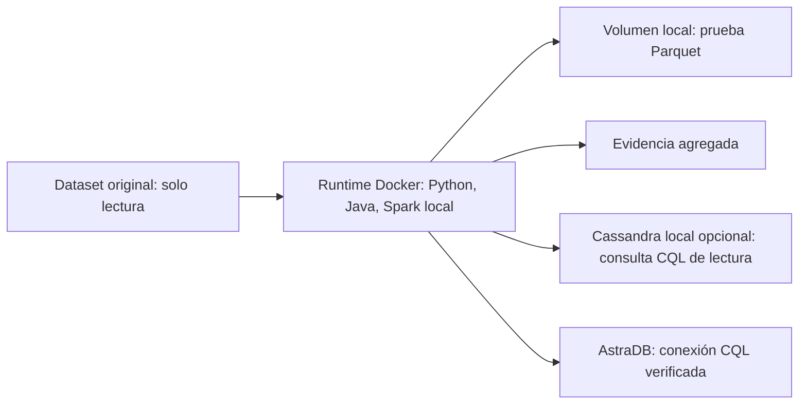
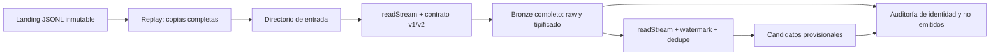
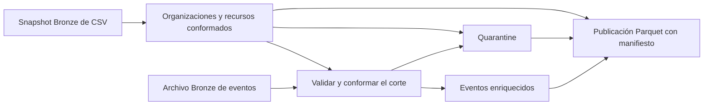

# Segunda entrega: implementación

## 1. Entorno y configuración

Se usa Docker Desktop con contenedores Linux y Compose: Python 3.11.15,
Java 17 y PySpark 3.5.8. Las dependencias Python están fijadas con hashes en
`requirements.txt`; las imágenes base, por digest. El parche de Java proviene
de los repositorios Debian y su versión efectiva se registra en la evidencia.
No se promete una reconstrucción binaria idéntica de los paquetes del sistema.

Docker aísla el runtime del Java instalado en Windows. Se adopta como entorno
equivalente a Colab: Santos Galarraga confirmó el 15/11/2026 que Docker está
permitido. La evidencia de ejecución comprueba su funcionamiento técnico.

### Decisión de almacenamiento

Para el flujo mínimo se revisa la elección de HDFS de la primera entrega:
Spark usará Parquet en un volumen local persistente, sin NameNode ni DataNodes.
La muestra no requiere almacenamiento distribuido y se prioriza reproducir el
flujo antes de agregar servicios. HDFS queda como alternativa de crecimiento.
Este entorno no demuestra alta disponibilidad ni tolerancia a la pérdida del
equipo. Los contratos de publicación dependientes de HDFS del diseño inicial
deberán adaptarse y probarse antes de implementarlos.



Este diagrama representa la prueba de entorno de la sección 1. Su prueba
Parquet usa dos filas sintéticas; de las fuentes verifica acceso, inventario
y hashes. La ingesta batch real se describe en la sección 2.

### Puesta en marcha

Requisitos: Docker Desktop en modo Linux y Compose v2. Presupuesto inicial:
6 GB de RAM disponibles para Docker y 5 GB de disco para imágenes y volúmenes.
Es una referencia de instalación, no un dimensionamiento productivo.

1. Extraer el ZIP del campus en una carpeta que contenga `datalake/landing`.
2. Copiar `.env.example` a `.env` y ajustar `DATASET_PATH` a esa carpeta.
   En Windows usar barras `/`; no apuntar al ZIP ni directamente a `landing`.
3. Crear una carpeta vacía `secrets/` en la raíz. Los secretos no se versionan.
4. Ejecutar desde la raíz del repositorio:

```sh
docker compose build runtime
docker compose run --rm runtime python -m unittest discover -s tests -v
docker compose run --rm runtime python scripts/check_environment.py
```

El primer build descarga Spark y Java. La configuración no secreta está en
`config/runtime.toml`. El dataset se monta sólo para lectura; Lake y evidencia
tienen rutas separadas. `lake` es un volumen administrado por Docker: no usarlo
como ubicación de los originales. No se necesita instalar Python/Java en Windows.

Para probar serving sin cuenta cloud, dejar `SERVING_MODE=local` en `.env`:

```sh
docker compose --profile local-serving up -d --wait --wait-timeout 360 cassandra
docker compose run --rm runtime python scripts/check_environment.py --serving
docker compose --profile local-serving stop cassandra
```

Cassandra sólo es accesible desde la red de Compose, sin puertos publicados al
host. Es un servicio de desarrollo sin autenticación; no debe exponerse a una
red compartida. La prueba consulta `system.local`; no crea keyspaces, tablas
ni datos de negocio. La carga del mart corresponde a la sección de serving.

### Preparar AstraDB

1. Crear una cuenta en [Astra](https://astra.datastax.com/) y una base compatible
   con conexiones CQL mediante driver; no alcanza con disponer de una colección
   para una API vectorial. Revisar las condiciones del plan antes de crearla.
2. Crear un keyspace, por ejemplo `cloud_provider`, desde la plataforma. En Astra
   la creación del keyspace se gestiona allí, no mediante `CREATE KEYSPACE` CQL.
3. Descargar el Secure Connect Bundle y guardarlo, sin extraer, como
   `secrets/secure-connect.zip`. Generar un token con acceso al keyspace.
4. Completar localmente en `.env`: `SERVING_MODE=astra`, `ASTRA_KEYSPACE` y
   `ASTRA_TOKEN`. No pegar el token en el chat, logs o documentación.
5. Ejecutar el mismo comando `check_environment.py --serving`. Para Astra no
   hace falta iniciar Cassandra local.

Sin esos datos, el chequeo informa `pending` y termina con código 1; no declara
una conexión exitosa. Un fallo de conexión informa sólo el tipo de error para
evitar volcar secretos. Revisar modo, base activa, permisos, bundle y salida
de red antes de reintentar. Nunca compartir el resultado de `docker compose
config` si contiene credenciales interpoladas.

### Evidencia y límites

Los comandos generan `evidence/environment/spark.json` y `serving.json`:
versiones efectivas, hashes de entradas, conteo y suma del round-trip Parquet,
y resultado de la consulta CQL. `--serving` exige que todos los chequeos pasen;
sin ese flag, serving queda explícitamente como no comprobado. Cada ejecución
actualiza su informe y escribe Parquet en un directorio nuevo del volumen.

La [ejecución verificada](../evidence/environment/README.md) completó siete
pruebas, el round-trip Parquet y una consulta real a AstraDB. También se había
comprobado la conexión a Cassandra local. El driver extrae el bundle en el
directorio temporal del contenedor mediante `use_default_tempdir`, conservando
el montaje de secretos en solo lectura.

La sección 1 está verificada y el uso de Docker está confirmado. La prueba
de conexión no acredita permisos de escritura ni carga desde Spark.

Para detener el entorno conservando los datos: `docker compose --profile
local-serving down`. Los volúmenes persisten; no usar `down -v` para un reinicio
normal. Si falta el dataset, corregir `.env`; si Cassandra aún inicia, esperar
su estado saludable. Si falta memoria, revisar los recursos de Docker antes
de aumentar los límites del proyecto.

Fuentes: [compatibilidad de Spark 3.5.8](https://spark.apache.org/docs/3.5.8/)
y [conexión Python a Astra](https://docs.datastax.com/en/astra-db-serverless/drivers/python-driver.html).

## 2. Contratos e ingesta batch a Bronze

Se incorporan customers_orgs, users y billing_monthly para cubrir el mínimo,
y resources para el enriquecimiento posterior. Los contratos versionados están
en `src/cloud_analytics/contracts.py`; no se infieren tipos. Todos los campos
no indicados en la tabla se conservan como string, incluidos IDs y `tags_json`.

| Fuente y clave | Tipos explícitos |
| --- | --- |
| customers_orgs: org_id | is_enterprise: boolean; signup_date: date; nps_score: decimal(38,12) |
| users: user_id | active: boolean; created_at y last_login: date |
| billing_monthly: invoice_id | month: date; subtotal, credits, taxes y exchange_rate_to_usd: decimal(38,12) |
| resources: resource_id | created_at: date |

Las fechas de estos CSV son `YYYY-MM-DD`, incluida la fecha del mes de billing.
Los booleanos admiten true/false sin distinguir mayúsculas. Los decimales
admiten signo y hasta 12 cifras fraccionarias; overflow, precisión excedida y
formatos no admitidos quedan nulos y señalados, sin redondeo silencioso. Vacíos
no equivalen a errores de conversión ni a cero. NPS decimal conserva los valores
de origen sin imponer todavía rango o escala de negocio.

### Lectura y trazabilidad

Un preflight secuencial comprueba encabezados exactos, cantidad de columnas y
archivos no vacíos. Spark lee los CSV con esquema string explícito y luego los
tipifica. Se admiten campos entrecomillados, comas, comillas escapadas y saltos
de línea dentro de un campo. La lectura conserva `raw`, una estructura con los
campos interpretados por el lector CSV: el original byte a byte permanece en
Landing. El preflight evita que filas cortas/largas se acepten silenciosamente.

Cada registro añade `ingest_ts` UTC, `ingest_date`, `source_file`, `source_hash`,
`batch_id`, `contract_version`, `source_record_hash`, `source_occurrences`,
`key_variants` y `parse_errors`. El hash de registro identifica su contenido CSV
interpretado, no un número de línea física. El hash de archivo permite volver
al original, incluso cuando un campo ocupa varias líneas.

Se colapsan sólo registros idénticos tras la lectura CSV, guardando el número
de copias en `source_occurrences`. Variantes distintas de una misma clave se
conservan y marcan `conflicting_key`; claves ausentes se marcan `missing_key`.
Los errores de tipos se registran por campo. Estas filas siguen en Bronze con
sus valores raw: no se descartan costos negativos ni se imputan créditos vacíos.
Normalización, referencias, reglas de negocio y quarantine corresponden a Silver.

### Publicación y reejecución

```text
/lake/bronze/batch_id=<id>/
  manifest.json
  customers_orgs/ingest_date=YYYY-MM-DD/*.parquet
  users/ingest_date=YYYY-MM-DD/*.parquet
  billing_monthly/ingest_date=YYYY-MM-DD/*.parquet
  resources/ingest_date=YYYY-MM-DD/*.parquet
```

Se adapta el orden de rutas del diseño inicial para publicar las cuatro fuentes
juntas. El manifiesto identifica cada fuente, esquema, entradas, conteos, errores
y archivos de salida con hashes. Leer cada fuente por su ruta del manifiesto;
no leer toda la raíz Bronze como si las cuatro fuentes tuvieran el mismo esquema.

El ID depende de hashes de entradas, contrato, implementación y versión de Spark.
Una repetición verifica archivos y checksums y devuelve `reused`, conservando
la fecha de ingesta original. Un cambio produce otro lote: no debe acumularse
como si fuera otro fragmento del mismo snapshot. La selección de snapshots
para Silver se implementará en su sección.

Se escribe primero en `.bronze-staging`, se verifica el round-trip Parquet y
que las entradas no hayan cambiado, y se promueve el directorio completo con
rename dentro del volumen local Linux. Un lock impide escritores concurrentes.
Las excepciones normales limpian el staging; una terminación forzada puede
dejar temporales sin publicar, que no deben consumirse. Estas garantías no se
extienden a otros backends. Un lote publicado alterado se rechaza, no se sobrescribe.

Se usa un archivo Parquet por fuente y fecha de ingesta para esta muestra,
sin fragmentar por organización. El preflight lee secuencialmente y Spark
procesa en local[2]; no se afirma escalabilidad distribuida medida.

### Ejecución y verificación

Con la configuración de la sección 1, ejecutar desde la raíz:

```sh
docker compose run --rm runtime python scripts/ingest_batch.py --report-name first
docker compose run --rm runtime python scripts/ingest_batch.py --report-name repeat
docker compose run --rm runtime python -m unittest discover -s tests -v
```

Los informes agregados quedan en `evidence/batch/first.json` y `repeat.json`;
no contienen filas, emails ni valores de campos personales. Los datos raw y
tipificados sólo quedan en el volumen local. `evidence_root` configura la raíz
común: los chequeos del entorno siguen escribiendo en su subcarpeta `environment`.

El comando devuelve código 1 ante fallos, con tipo de error y código seguro
cuando corresponde. Encabezado o estructura inválidos bloquean todo el lote;
errores de conversión no impiden conservar la fila en Bronze. Ver los conteos
y la comparación entre ejecuciones en [evidencia batch](../evidence/batch/README.md).

## 3. Streaming de eventos a Bronze

Se implementan dos consultas Structured Streaming con checkpoints separados.
La primera archiva todas las líneas JSONL en Parquet; la segunda lee ese archivo
Bronze, aplica watermark y deduplicación por `event_id` y escribe candidatos.
Se ejecutan en ese orden con `availableNow`: cada consulta procesa los archivos
disponibles en micro-lotes y termina. Al volver a ejecutarla retoma su checkpoint.
No es una lectura batch ni una demostración de latencia continua de 60 segundos.



### Contrato y reproducción

`usage_contract.py` declara el superset v1/v2. Se lee cada línea como texto
y se interpreta con `from_json` y esquema explícito, conservando `raw_json`.
Costos, consumo y carbono usan decimal(38,12), tokens bigint, versión int y
tiempo timestamp UTC. Se admiten números como texto y notación científica
representable a la escala elegida. Campos v2 ausentes quedan nulos, no cero.
JSON malformado, tiempos inválidos y versiones desconocidas quedan registrados
en `parse_errors` y conservados en el archivo completo.

La trazabilidad incluye `stream_id`, contrato, archivo y SHA256 original, hash
de línea, `ingest_ts` e `ingest_date`. Los IDs de micro-lote y el progreso se
conservan en checkpoints, metadatos nativos del sink y evidencia de la query;
no se agrega un batch_id inventado a cada fila.

`replay_usage.py` copia archivos completos a un temporal y los renombra al
directorio observado sólo después de verificar hashes. No modifica originales
ni reordena eventos dentro del archivo. `--interval` regula segundos entre
archivos nuevos y `--limit` limita cuántos se ofrecen en una invocación.
Repetir el replay verifica/reutiliza las copias existentes. Replay y consumidor
no corren simultáneamente: un lock evita cambiar el corte durante el proceso.

### Watermark, conflictos y tardanza

El valor inicial es 60 días, por el desorden temporal del paquete. Se configura
junto con `max_files_per_trigger=20` en `config/runtime.toml`. La deduplicación
usa `dropDuplicatesWithinWatermark`; su garantía depende del margen temporal
y del estado retenido, no de conservar para siempre todos los IDs.

Bronze completo se escribe **antes** del operador con estado: duplicados,
conflictos y eventos fuera del margen siguen disponibles. Los eventos con
identidad/tiempo inválidos o versión desconocida no entran en la deduplicación.
Los errores de otras medidas se conservan para su evaluación independiente.

Después de ambas consultas se audita todo el archivo retenido. Más de una
variante interpretada por event_id identifica un conflicto; se guardan sus
IDs y se excluyen al contar candidatos sin conflictos. Una variante puede
haber sido emitida antes de descubrir otra: la salida deduplicada es provisional
y **no debe usarse directamente para métricas ni serving**. Silver deberá partir
del archivo completo y aplicar sus reglas por medida.

También se guardan en `deferred` las contribuciones elegibles sin una salida
equivalente, incluidos eventos tardíos y variantes descartadas por deduplicación.
No se afirma que todas sean tardías: los descartes por watermark se registran
aparte en las métricas de Spark. JSON y tiempos inválidos siguen en el archivo
completo con sus errores. No se implementan aún reparaciones batch ni quarantine
de negocio; éstas corresponden a las etapas siguientes.

### Estado, reinicio y ejecución

Las rutas del volumen son:

```text
/lake/streams/<stream-id>/inbox/
/lake/streams/<stream-id>/checkpoints/{archive,dedup}/
/lake/streams/<stream-id>/audits/<revision>/{conflicts,deferred}/
/lake/bronze/usage_events/stream_id=<stream-id>/ingest_date=.../
/lake/bronze/usage_candidates/stream_id=<stream-id>/ingest_date=.../
```

Cada sink Parquet tiene su propio log de archivos comprometidos. Se deben leer
las raíces de cada sink, sin glob de particiones que ignore `_spark_metadata`.
La auditoría publica una revisión completa y `audit-head.json`; se invalida la
referencia previa al comenzar otra corrida para no presentar un corte viejo
como vigente si falla una etapa. Los temporales y auditorías quedan fuera de Git.

Se rechaza reutilizar un stream si cambia el parser, watermark, Spark o número
de particiones del estado, o si faltan checkpoints de una salida existente.
Para un reproceso deliberado usar un nuevo `--stream-id` en ambos comandos;
no borrar sólo checkpoints ni sumar entre sí ejecuciones del mismo histórico.
La sesión predeterminada y verificada es `usage-v1`.

```sh
docker compose run --rm runtime python scripts/replay_usage.py --limit 60
docker compose run --rm runtime python scripts/ingest_stream.py --report-name first
docker compose run --rm runtime python scripts/replay_usage.py
docker compose run --rm runtime python scripts/ingest_stream.py --report-name resumed
docker compose run --rm runtime python scripts/ingest_stream.py --report-name repeat
```

En una sesión ya procesada no se vuelven a ingerir esos archivos. Las pruebas
sintéticas usan sesiones temporales para demostrar duplicados, tardanza,
conflictos y fallos sin mezclar datos artificiales con el paquete real.
Los informes agregados están en [evidence/streaming](../evidence/streaming/README.md).
El reporte conserva hasta los últimos 1000 registros de progreso de cada query
de esa invocación; no es un sistema permanente de monitoreo.

Referencias: [Structured Streaming 3.5.8](https://spark.apache.org/docs/3.5.8/structured-streaming-programming-guide.html)
y [deduplicación dentro del watermark](https://spark.apache.org/docs/3.5.8/api/python/reference/pyspark.sql/api/pyspark.sql.DataFrame.dropDuplicatesWithinWatermark.html).

## 4. Silver, calidad y quarantine



### Selección de entradas

Usar el `manifest.batch_id` que devuelve `ingest_batch.py` y el `cut_id`
de `--inspect-cut`. El job lee los maestros de ese snapshot y el archivo
completo de la sesión indicada desde su raíz Parquet. Spark resuelve los
archivos comprometidos con `_spark_metadata`. Silver fija el corte mediante
la sesión, las rutas relativas, los tamaños y los SHA-256 de esos archivos.
Un lock compartido con el consumidor Bronze impide que el archivo avance
mientras Silver lo inspecciona o transforma. Si avanzó entre comandos, la
publicación rechaza el corte anterior. La evidencia usa `usage-v1`.

```sh
docker compose run --rm runtime python scripts/build_silver.py --stream-id usage-v1 --inspect-cut
docker compose run --rm runtime python scripts/build_silver.py --stream-id usage-v1 --batch-id <batch_id> --archive-cut <cut_id> --report-name first
```

### Contrato y reglas

Silver usa el superset tipificado de Bronze con fecha de evento UTC, montos
y consumo decimal(38,12) y tokens bigint. Quita espacios extremos de claves
y normaliza categorías a minúsculas. Organizaciones y recursos se conforman
a un registro por clave a partir de sus atributos publicados. Las variantes
equivalentes conservan la multiplicidad en su linaje. Una clave de maestro
con atributos contradictorios o una variante inválida queda en quarantine.
Las dimensiones corresponden al snapshot seleccionado, sin historia efectiva.

En eventos se exige identidad, timestamp válido, esquema conocido y
referencias verificables. El recurso debe coincidir en organización, servicio
y región. Una variante inválida con ID conocido o un desacuerdo en fecha
o dimensiones bloquea ese ID completo. Si coinciden, se comparan las medidas
por separado, incluyendo los valores crudos cuando falla un cast. Se publica
una fila por ID con linaje de origen y el conjunto de versiones del esquema.
`schema_version` indica el formato. Un campo opcional ausente en una copia
puede complementarse con un valor unívoco reportado por otra.

| Medida | Validación |
| --- | --- |
| Costo | Decimal presente y mayor o igual a cero. La consigna admite `>= -0.01`; se separan todos los negativos porque la fuente carece de información para distinguir ajustes autorizados. Los importes positivos altos siguen utilizables. |
| Consumo | Valor presente y no negativo, con pareja exacta `requests/count`, `cpu_hours/hours` o `storage_gb_hours/gb_hours`. Las tres columnas derivadas aportan valor sólo para su métrica y unidad válidas. |
| Carbono | Decimal no negativo cuando se reporta. |
| Tokens | Entero no negativo de servicio `genai` cuando se reporta. |

Cada medida queda `valid`, `quarantined` o `absent` (carbono y tokens
opcionales). Una contradicción en una medida bloquea su aporte y sus
variantes se conservan. Las medidas bloqueadas o ausentes salen con valor
nulo. Una fila de identidad válida se conserva para medir cobertura incluso
si ninguna medida es utilizable. El costo incremental pertenece al
evento; revenue pertenece a facturación.

Quarantine registra una incidencia por fila Bronze afectada y ámbito
(`master`, `event`, `cost`, `usage`, `carbon` o `tokens`), con uno o
más motivos. Contiene clave, archivo, hashes, contrato, fecha de ingesta,
sesión o batch y payload original. El detalle se conserva en el volumen local
con acceso restringido al entorno del proyecto. Un ID en Silver puede aparecer
en varias incidencias. Un bloqueo de evento completo se registra en el ámbito
`event` para cada variante afectada. Los informes versionados sólo incluyen
métricas, motivos y metadatos técnicos.

### Publicación y reejecución

```text
/lake/silver/publication_id=<id>/
  manifest.json
  customers_orgs/
  resources/
  usage_events/event_date=YYYY-MM-DD/
  quarantine/ingest_date=YYYY-MM-DD/
```

Eventos se podan por día UTC. Quarantine usa día de ingesta para admitir
fechas de evento inválidas. Los maestros se leen completos por snapshot.
Una tabla vacía conserva un Parquet con esquema en su raíz. Se verifica el
conteo y los tipos al releer cada tabla, luego el manifiesto y sus checksums.
Un rename local de todo el directorio publica las cuatro tablas juntas. Un
fallo previo al rename deja la salida fuera del directorio publicado y el
reintento usa otro temporal. Tras una interrupción abrupta pueden quedar
temporales sin promover. La reejecución con las mismas entradas y código
verifica y reutiliza el ID. La ruta de cada publicación permanece disponible
como corte histórico. La reconstrucción de un corte anterior requiere
volver a disponer de ese archivo Bronze en su estado original.

Resultados, casos de prueba y comandos exactos en la
[evidencia de Silver](../evidence/silver/README.md).

## Secciones siguientes

Pendientes, en orden: 5. agregaciones Gold y analítica; 6. serving del
mart y consultas; 7. integración e idempotencia; 8. documentación final y backlog.
