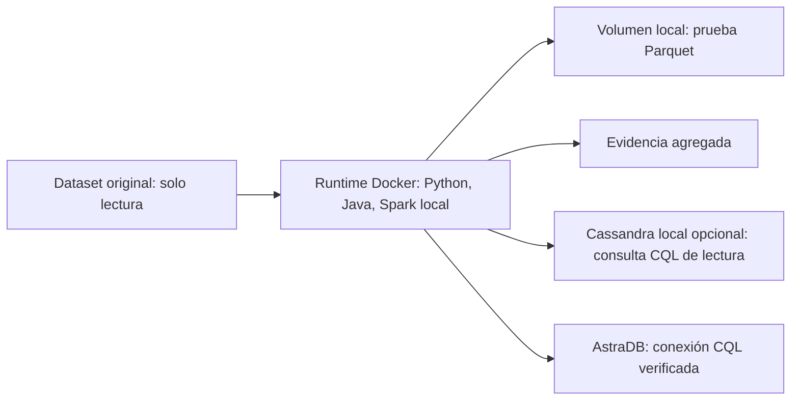

# Segunda entrega: implementación

## 1. Entorno y configuración

Se usa Docker Desktop con contenedores Linux y Compose: Python 3.11.15,
Java 17 y PySpark 3.5.8. Las dependencias Python están fijadas con hashes en
`requirements.txt`; las imágenes base, por digest. El parche de Java proviene
de los repositorios Debian y su versión efectiva se registra en la evidencia.
No se promete una reconstrucción binaria idéntica de los paquetes del sistema.

Docker aísla el runtime del Java instalado en Windows. Se adopta como entorno
equivalente a Colab: Santos Galarraga confirmó el 15/11/2026 que Docker está
permitido. La evidencia de ejecución comprueba su funcionamiento técnico.

### Decisión de almacenamiento

Para el flujo mínimo se revisa la elección de HDFS de la primera entrega:
Spark usará Parquet en un volumen local persistente, sin NameNode ni DataNodes.
La muestra no requiere almacenamiento distribuido y se prioriza reproducir el
flujo antes de agregar servicios. HDFS queda como alternativa de crecimiento.
Este entorno no demuestra alta disponibilidad ni tolerancia a la pérdida del
equipo. Los contratos de publicación dependientes de HDFS del diseño inicial
deberán adaptarse y probarse antes de implementarlos.



Este diagrama representa la sección 1. No hay ingesta Bronze, transformaciones
Silver/Gold ni carga de marts implementadas. La prueba Parquet usa dos filas
sintéticas; de las fuentes sólo se verifica acceso, inventario y hashes.

### Puesta en marcha

Requisitos: Docker Desktop en modo Linux y Compose v2. Presupuesto inicial:
6 GB de RAM disponibles para Docker y 5 GB de disco para imágenes y volúmenes.
Es una referencia de instalación, no un dimensionamiento productivo.

1. Extraer el ZIP del campus en una carpeta que contenga `datalake/landing`.
2. Copiar `.env.example` a `.env` y ajustar `DATASET_PATH` a esa carpeta.
   En Windows usar barras `/`; no apuntar al ZIP ni directamente a `landing`.
3. Crear una carpeta vacía `secrets/` en la raíz. Los secretos no se versionan.
4. Ejecutar desde la raíz del repositorio:

```sh
docker compose build runtime
docker compose run --rm runtime python -m unittest discover -s tests -v
docker compose run --rm runtime python scripts/check_environment.py
```

El primer build descarga Spark y Java. La configuración no secreta está en
`config/runtime.toml`. El dataset se monta sólo para lectura; Lake y evidencia
tienen rutas separadas. `lake` es un volumen administrado por Docker: no usarlo
como ubicación de los originales. No se necesita instalar Python/Java en Windows.

Para probar serving sin cuenta cloud, dejar `SERVING_MODE=local` en `.env`:

```sh
docker compose --profile local-serving up -d --wait --wait-timeout 360 cassandra
docker compose run --rm runtime python scripts/check_environment.py --serving
docker compose --profile local-serving stop cassandra
```

Cassandra sólo es accesible desde la red de Compose, sin puertos publicados al
host. Es un servicio de desarrollo sin autenticación; no debe exponerse a una
red compartida. La prueba consulta `system.local`; no crea keyspaces, tablas
ni datos de negocio. La carga del mart corresponde a la sección de serving.

### Preparar AstraDB

1. Crear una cuenta en [Astra](https://astra.datastax.com/) y una base compatible
   con conexiones CQL mediante driver; no alcanza con disponer de una colección
   para una API vectorial. Revisar las condiciones del plan antes de crearla.
2. Crear un keyspace, por ejemplo `cloud_provider`, desde la plataforma. En Astra
   la creación del keyspace se gestiona allí, no mediante `CREATE KEYSPACE` CQL.
3. Descargar el Secure Connect Bundle y guardarlo, sin extraer, como
   `secrets/secure-connect.zip`. Generar un token con acceso al keyspace.
4. Completar localmente en `.env`: `SERVING_MODE=astra`, `ASTRA_KEYSPACE` y
   `ASTRA_TOKEN`. No pegar el token en el chat, logs o documentación.
5. Ejecutar el mismo comando `check_environment.py --serving`. Para Astra no
   hace falta iniciar Cassandra local.

Sin esos datos, el chequeo informa `pending` y termina con código 1; no declara
una conexión exitosa. Un fallo de conexión informa sólo el tipo de error para
evitar volcar secretos. Revisar modo, base activa, permisos, bundle y salida
de red antes de reintentar. Nunca compartir el resultado de `docker compose
config` si contiene credenciales interpoladas.

### Evidencia y límites

Los comandos generan `evidence/environment/spark.json` y `serving.json`:
versiones efectivas, hashes de entradas, conteo y suma del round-trip Parquet,
y resultado de la consulta CQL. `--serving` exige que todos los chequeos pasen;
sin ese flag, serving queda explícitamente como no comprobado. Cada ejecución
actualiza su informe y escribe Parquet en un directorio nuevo del volumen.

La [ejecución verificada](../evidence/environment/README.md) completó siete
pruebas, el round-trip Parquet y una consulta real a AstraDB. También se había
comprobado la conexión a Cassandra local. El driver extrae el bundle en el
directorio temporal del contenedor mediante `use_default_tempdir`, conservando
el montaje de secretos en solo lectura.

La sección 1 está verificada y el uso de Docker está confirmado. La prueba
de conexión no acredita permisos de escritura ni carga desde Spark.

Para detener el entorno conservando los datos: `docker compose --profile
local-serving down`. Los volúmenes persisten; no usar `down -v` para un reinicio
normal. Si falta el dataset, corregir `.env`; si Cassandra aún inicia, esperar
su estado saludable. Si falta memoria, revisar los recursos de Docker antes
de aumentar los límites del proyecto.

Fuentes: [compatibilidad de Spark 3.5.8](https://spark.apache.org/docs/3.5.8/)
y [conexión Python a Astra](https://docs.datastax.com/en/astra-db-serverless/drivers/python-driver.html).

## Secciones siguientes

Pendientes, en orden: 2. contratos y batch a Bronze; 3. streaming a Bronze;
4. Silver, calidad y quarantine; 5. features, Gold y analítica; 6. serving del
mart y consultas; 7. integración e idempotencia; 8. documentación final y backlog.
