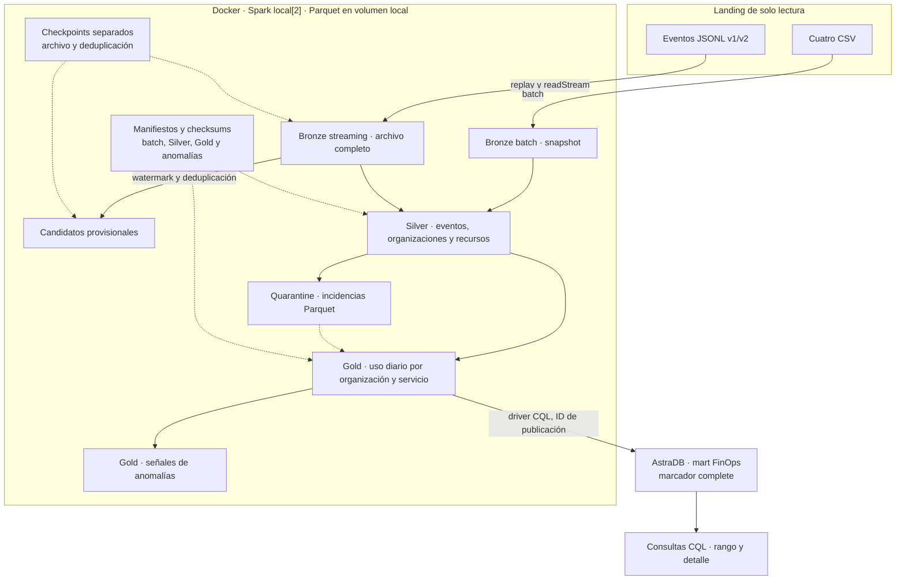

# Segunda entrega: implementación

## Arquitectura ejecutada



El MVP combina batch para maestros y publicación por corte con Structured
Streaming para archivar y deduplicar eventos. Comparte un solo conformado y
un único cálculo diario desde Silver, lo que evita mantener dos vistas de
serving al estilo Lambda. Los maestros y sus snapshots siguen explícitos,
sin convertir cada fuente en un stream como en Kappa. La publicación
operativa por hora y los objetivos de frescura pertenecen al diseño
productivo. [Diseño histórico y alternativas](primera-entrega.md#elección-del-patrón).

## 1. Entorno y configuración

Se usa Docker Desktop con contenedores Linux y Compose: Python 3.11.15,
Java 17 y PySpark 3.5.8. Las dependencias Python están fijadas con hashes en
`requirements.txt`; las imágenes base, por digest. El parche de Java proviene
de los repositorios Debian y su versión efectiva se registra en la evidencia.
No se promete una reconstrucción binaria idéntica de los paquetes del sistema.

Docker aísla el runtime del Java instalado en Windows. Para el proyecto se
confirmó el uso permitido de Docker como entorno equivalente a Colab el 15/11/2026.
[Evidencia de funcionamiento y versiones](../evidence/environment/README.md).

### Decisión de almacenamiento

El volumen Docker persistente alcanza para la muestra y reduce el costo de
operación. Los jobs escriben Parquet local y publican snapshots mediante rename
dentro del mismo volumen. HDFS queda como alternativa de crecimiento. La
pérdida del equipo, una migración de backend y la alta disponibilidad requieren
validaciones independientes.

### Puesta en marcha

Requisitos: Docker Desktop en modo Linux y Compose v2. Presupuesto inicial:
6 GB de RAM disponibles para Docker y 5 GB de disco para imágenes y volúmenes.
Es una referencia de instalación, no un dimensionamiento productivo.

1. Extraer el ZIP del campus en una carpeta que contenga `datalake/landing`.
2. Si todavía no existe `.env`, copiar `.env.example` a `.env`. Ajustar
   `DATASET_PATH` a la carpeta extraída.
   En Windows usar barras `/`; no apuntar al ZIP ni directamente a `landing`.
3. Crear una carpeta vacía `secrets/` en la raíz. Los secretos no se versionan.
4. Ejecutar desde la raíz del repositorio:

```sh
docker compose build runtime
docker compose run --rm --no-deps runtime python scripts/check_environment.py
```

El primer build descarga Spark y Java. La configuración no secreta está en
`config/runtime.toml`. El dataset se monta sólo para lectura; Lake y evidencia
tienen rutas separadas. `lake` es un volumen administrado por Docker: no usarlo
como ubicación de los originales. No se necesita instalar Python/Java en Windows.

Para probar serving sin cuenta cloud, dejar `SERVING_MODE=local` en `.env`:

```sh
docker compose --profile local-serving up -d --wait --wait-timeout 360 cassandra
docker compose run --rm runtime python scripts/check_environment.py --serving
docker compose --profile local-serving stop cassandra
```

Cassandra local queda en la red de Compose sin puertos publicados al host.
El chequeo usa `system.local` para verificar la conexión CQL.

### Preparar AstraDB

1. Crear una cuenta en [Astra](https://astra.datastax.com/) y una base compatible
   con conexiones CQL mediante driver; no alcanza con disponer de una colección
   para una API vectorial. Revisar las condiciones del plan antes de crearla.
2. Crear un keyspace, por ejemplo `cloud_provider`, desde la plataforma. En Astra
   la creación del keyspace se gestiona allí, no mediante `CREATE KEYSPACE` CQL.
3. Descargar el Secure Connect Bundle y guardarlo, sin extraer, como
   `secrets/secure-connect.zip`. Generar un token con acceso al keyspace.
4. Completar localmente en `.env`: `SERVING_MODE=astra`, `ASTRA_KEYSPACE` y
   `ASTRA_TOKEN`. No pegar el token en el chat, logs o documentación.
5. Ejecutar el chequeo Astra del [guion de demo](#guion-de-demo).

Sin esos datos, el chequeo informa `pending` y termina con código 1; no declara
una conexión exitosa. Un fallo de conexión informa sólo el tipo de error para
evitar volcar secretos. Revisar modo, base activa, permisos, bundle y salida
de red antes de reintentar. Nunca compartir el resultado de `docker compose
config` si contiene credenciales interpoladas.

El chequeo registra versiones, hashes del dataset y un round-trip de Parquet
sintético. Con `--serving` agrega una consulta CQL de lectura. La verificación
de escritura del mart está en la sección 6. El comando `stop` de la prueba
local conserva el volumen de Cassandra.

[Documentación de Spark 3.5.8](https://spark.apache.org/docs/3.5.8/).

## 2. Contratos e ingesta batch a Bronze

Se incorporan customers_orgs, users y billing_monthly para cubrir el mínimo,
y resources para el enriquecimiento posterior. Los contratos versionados están
en `src/cloud_analytics/contracts.py`; no se infieren tipos. Todos los campos
no indicados en la tabla se conservan como string, incluidos IDs y `tags_json`.

| Fuente y clave | Tipos explícitos |
| --- | --- |
| customers_orgs: org_id | is_enterprise: boolean; signup_date: date; nps_score: decimal(38,12) |
| users: user_id | active: boolean; created_at y last_login: date |
| billing_monthly: invoice_id | month: date; subtotal, credits, taxes y exchange_rate_to_usd: decimal(38,12) |
| resources: resource_id | created_at: date |

Las fechas de estos CSV son `YYYY-MM-DD`, incluida la fecha del mes de billing.
Los booleanos admiten true/false sin distinguir mayúsculas. Los decimales
admiten signo y hasta 12 cifras fraccionarias; overflow, precisión excedida y
formatos no admitidos quedan nulos y señalados, sin redondeo silencioso. Vacíos
no equivalen a errores de conversión ni a cero. NPS decimal conserva los valores
de origen sin imponer todavía rango o escala de negocio.

### Lectura y trazabilidad

Un preflight secuencial comprueba encabezados exactos, cantidad de columnas y
archivos no vacíos. Spark lee los CSV con esquema string explícito y luego los
tipifica. Se admiten campos entrecomillados, comas, comillas escapadas y saltos
de línea dentro de un campo. La lectura conserva `raw`, una estructura con los
campos interpretados por el lector CSV: el original byte a byte permanece en
Landing. El preflight evita que filas cortas/largas se acepten silenciosamente.

Cada registro añade `ingest_ts` UTC, `ingest_date`, `source_file`, `source_hash`,
`batch_id`, `contract_version`, `source_record_hash`, `source_occurrences`,
`key_variants` y `parse_errors`. El hash de registro identifica su contenido CSV
interpretado, no un número de línea física. El hash de archivo permite volver
al original, incluso cuando un campo ocupa varias líneas.

Se colapsan sólo registros idénticos tras la lectura CSV, guardando el número
de copias en `source_occurrences`. Variantes distintas de una misma clave se
conservan y marcan `conflicting_key`; claves ausentes se marcan `missing_key`.
Los errores de tipos se registran por campo. Estas filas siguen en Bronze con
sus valores raw: no se descartan costos negativos ni se imputan créditos vacíos.
Normalización, referencias, reglas de negocio y quarantine corresponden a Silver.

### Publicación y reejecución

```text
/lake/bronze/batch_id=<id>/
  manifest.json
  customers_orgs/ingest_date=YYYY-MM-DD/*.parquet
  users/ingest_date=YYYY-MM-DD/*.parquet
  billing_monthly/ingest_date=YYYY-MM-DD/*.parquet
  resources/ingest_date=YYYY-MM-DD/*.parquet
```

Se adapta el orden de rutas del diseño inicial para publicar las cuatro fuentes
juntas. El manifiesto identifica cada fuente, esquema, entradas, conteos, errores
y archivos de salida con hashes. Leer cada fuente por su ruta del manifiesto;
no leer toda la raíz Bronze como si las cuatro fuentes tuvieran el mismo esquema.

El ID depende de hashes de entradas, contrato, implementación y versión de Spark.
Una repetición verifica archivos y checksums y devuelve `reused`, conservando
la fecha de ingesta original. Un cambio produce otro lote: no debe acumularse
como si fuera otro fragmento del mismo snapshot. Silver recibe el ID batch
de forma explícita.

Se escribe primero en `.bronze-staging`, se verifica el round-trip Parquet y
que las entradas no hayan cambiado, y se promueve el directorio completo con
rename dentro del volumen local Linux. Un lock impide escritores concurrentes.
Las excepciones normales limpian el staging; una terminación forzada puede
dejar temporales sin publicar, que no deben consumirse. Estas garantías no se
extienden a otros backends. Un lote publicado alterado se rechaza, no se sobrescribe.

Se usa un archivo Parquet por fuente y fecha de ingesta para esta muestra,
sin fragmentar por organización. El preflight lee secuencialmente y Spark
procesa en local[2]; no se afirma escalabilidad distribuida medida.

### Ejecución y verificación

Con la configuración de la sección 1, ejecutar desde la raíz:

```sh
docker compose run --rm --no-deps runtime python scripts/ingest_batch.py --report-name revision
```

El comando devuelve código 1 ante fallos, con tipo de error y código seguro
cuando corresponde. Encabezado o estructura inválidos bloquean todo el lote;
errores de conversión no impiden conservar la fila en Bronze. Ver los conteos
y la comparación entre ejecuciones en [evidencia batch](../evidence/batch/README.md).

## 3. Streaming de eventos a Bronze

Se implementan dos consultas Structured Streaming con checkpoints separados.
La primera archiva todas las líneas JSONL en Parquet; la segunda lee ese archivo
Bronze, aplica watermark y deduplicación por `event_id` y escribe candidatos.
Se ejecutan en ese orden con `availableNow`: cada consulta procesa los archivos
disponibles en micro-lotes y termina. Al volver a ejecutarla retoma su checkpoint.
No es una lectura batch ni una demostración de latencia continua de 60 segundos.

### Contrato y reproducción

`usage_contract.py` declara el superset v1/v2. Se lee cada línea como texto
y se interpreta con `from_json` y esquema explícito, conservando `raw_json`.
Costos, consumo y carbono usan decimal(38,12), tokens bigint, versión int y
tiempo timestamp UTC. Se admiten números como texto y notación científica
representable a la escala elegida. Campos v2 ausentes quedan nulos, no cero.
JSON malformado, tiempos inválidos y versiones desconocidas quedan registrados
en `parse_errors` y conservados en el archivo completo.

La trazabilidad incluye `stream_id`, contrato, archivo y SHA256 original, hash
de línea, `ingest_ts` e `ingest_date`. Los IDs de micro-lote y el progreso se
conservan en checkpoints, metadatos nativos del sink y evidencia de la query;
no se agrega un batch_id inventado a cada fila.

`replay_usage.py` copia archivos completos a un temporal y los renombra al
directorio observado sólo después de verificar hashes. No modifica originales
ni reordena eventos dentro del archivo. `--interval` regula segundos entre
archivos nuevos y `--limit` limita cuántos se ofrecen en una invocación.
Repetir el replay verifica/reutiliza las copias existentes. Replay y consumidor
no corren simultáneamente: un lock evita cambiar el corte durante el proceso.

### Watermark, conflictos y tardanza

El valor inicial es 60 días, por el desorden temporal del paquete. Se configura
junto con `max_files_per_trigger=20` en `config/runtime.toml`. La deduplicación
usa `dropDuplicatesWithinWatermark`; su garantía depende del margen temporal
y del estado retenido, no de conservar para siempre todos los IDs.

Bronze completo se escribe **antes** del operador con estado: duplicados,
conflictos y eventos fuera del margen siguen disponibles. Los eventos con
identidad/tiempo inválidos o versión desconocida no entran en la deduplicación.
Los errores de otras medidas se conservan para su evaluación independiente.

Después de ambas consultas se audita todo el archivo retenido. Más de una
variante interpretada por event_id identifica un conflicto; se guardan sus
IDs y se excluyen al contar candidatos sin conflictos. Una variante puede
haber sido emitida antes de descubrir otra: la salida deduplicada es provisional
y queda para auditoría. Silver parte
del archivo completo y aplicar sus reglas por medida.

También se guardan en `deferred` las contribuciones elegibles sin una salida
equivalente, incluidos eventos tardíos y variantes descartadas por deduplicación.
No se afirma que todas sean tardías: los descartes por watermark se registran
aparte en las métricas de Spark. JSON y tiempos inválidos siguen en el archivo
completo con sus errores. Silver publica quarantine y reconstruye desde el
corte retenido. El recálculo incremental por grupos corregidos queda pendiente.

### Estado, reinicio y ejecución

Las rutas del volumen son:

```text
/lake/streams/<stream-id>/inbox/
/lake/streams/<stream-id>/checkpoints/{archive,dedup}/
/lake/streams/<stream-id>/audits/<revision>/{conflicts,deferred}/
/lake/bronze/usage_events/stream_id=<stream-id>/ingest_date=.../
/lake/bronze/usage_candidates/stream_id=<stream-id>/ingest_date=.../
```

Cada sink Parquet tiene su propio log de archivos comprometidos. Se deben leer
las raíces de cada sink, sin glob de particiones que ignore `_spark_metadata`.
La auditoría publica una revisión completa y `audit-head.json`; se invalida la
referencia previa al comenzar otra corrida para no presentar un corte viejo
como vigente si falla una etapa. Los temporales y auditorías quedan fuera de Git.

Se rechaza reutilizar un stream si cambia el parser, watermark, Spark o número
de particiones del estado, o si faltan checkpoints de una salida existente.
Para un reproceso deliberado usar un nuevo `--stream-id` en ambos comandos;
no borrar sólo checkpoints ni sumar entre sí ejecuciones del mismo histórico.
La sesión predeterminada y verificada es `usage-v1`.

```sh
docker compose run --rm --no-deps runtime python scripts/replay_usage.py --stream-id usage-v1
docker compose run --rm --no-deps runtime python scripts/ingest_stream.py --stream-id usage-v1 --report-name revision
```

En una sesión ya procesada no se vuelven a ingerir esos archivos. Las pruebas
sintéticas usan sesiones temporales para demostrar duplicados, tardanza,
conflictos y fallos sin mezclar datos artificiales con el paquete real.
Los informes agregados están en [evidence/streaming](../evidence/streaming/README.md).
El reporte conserva hasta los últimos 1000 registros de progreso de cada query
de esa invocación; no es un sistema permanente de monitoreo.

Referencias: [Structured Streaming 3.5.8](https://spark.apache.org/docs/3.5.8/structured-streaming-programming-guide.html)
y [deduplicación dentro del watermark](https://spark.apache.org/docs/3.5.8/api/python/reference/pyspark.sql/api/pyspark.sql.DataFrame.dropDuplicatesWithinWatermark.html).

## 4. Silver, calidad y quarantine

### Selección de entradas

Usar el `manifest.batch_id` que devuelve `ingest_batch.py` y el `cut_id`
de `--inspect-cut`. El job lee los maestros de ese snapshot y el archivo
completo de la sesión indicada desde su raíz Parquet. Spark resuelve los
archivos comprometidos con `_spark_metadata`. Silver fija el corte mediante
la sesión, las rutas relativas, los tamaños y los SHA-256 de esos archivos.
Un lock compartido con el consumidor Bronze impide que el archivo avance
mientras Silver lo inspecciona o transforma. Si avanzó entre comandos, la
publicación rechaza el corte anterior. La evidencia usa `usage-v1`.

```sh
docker compose run --rm runtime python scripts/build_silver.py --stream-id usage-v1 --inspect-cut
docker compose run --rm runtime python scripts/build_silver.py --stream-id usage-v1 --batch-id <batch_id> --archive-cut <cut_id> --report-name revision
```

### Contrato y reglas

Silver usa el superset tipificado de Bronze con fecha de evento UTC, montos
y consumo decimal(38,12) y tokens bigint. Quita espacios extremos de claves
y normaliza categorías a minúsculas. Organizaciones y recursos se conforman
a un registro por clave a partir de sus atributos publicados. Las variantes
equivalentes conservan la multiplicidad en su linaje. Una clave de maestro
con atributos contradictorios o una variante inválida queda en quarantine.
Las dimensiones corresponden al snapshot seleccionado, sin historia efectiva.

En eventos se exige identidad, timestamp válido, esquema conocido y
referencias verificables. El recurso debe coincidir en organización, servicio
y región. Una variante inválida con ID conocido o un desacuerdo en fecha
o dimensiones bloquea ese ID completo. Si coinciden, se comparan las medidas
por separado, incluyendo los valores crudos cuando falla un cast. Se publica
una fila por ID con linaje de origen y el conjunto de versiones del esquema.
`schema_version` indica el formato. Un campo opcional ausente en una copia
puede complementarse con un valor unívoco reportado por otra.

| Medida | Validación |
| --- | --- |
| Costo | Decimal presente y mayor o igual a cero. La consigna admite `>= -0.01`; se separan todos los negativos porque la fuente carece de información para distinguir ajustes autorizados. Los importes positivos altos siguen utilizables. |
| Consumo | Valor presente y no negativo, con pareja exacta `requests/count`, `cpu_hours/hours` o `storage_gb_hours/gb_hours`. Las tres columnas derivadas aportan valor sólo para su métrica y unidad válidas. |
| Carbono | Decimal no negativo cuando se reporta. |
| Tokens | Entero no negativo de servicio `genai` cuando se reporta. |

Cada medida queda `valid`, `quarantined` o `absent` (carbono y tokens
opcionales). Una contradicción en una medida bloquea su aporte y sus
variantes se conservan. Las medidas bloqueadas o ausentes salen con valor
nulo. Una fila de identidad válida se conserva para medir cobertura incluso
si ninguna medida es utilizable. El costo incremental pertenece al
evento; revenue pertenece a facturación.

Quarantine registra una incidencia por fila Bronze afectada y ámbito
(`master`, `event`, `cost`, `usage`, `carbon` o `tokens`), con uno o
más motivos. Contiene clave, archivo, hashes, contrato, fecha de ingesta,
sesión o batch y payload original. El detalle se conserva en el volumen local
con acceso restringido al entorno del proyecto. Un ID en Silver puede aparecer
en varias incidencias. Un bloqueo de evento completo se registra en el ámbito
`event` para cada variante afectada. Los informes versionados sólo incluyen
métricas, motivos y metadatos técnicos.

### Publicación y reejecución

```text
/lake/silver/publication_id=<id>/
  manifest.json
  customers_orgs/
  resources/
  usage_events/event_date=YYYY-MM-DD/
  quarantine/ingest_date=YYYY-MM-DD/
```

Eventos se podan por día UTC. Quarantine usa día de ingesta para admitir
fechas de evento inválidas. Los maestros se leen completos por snapshot.
Una tabla vacía conserva un Parquet con esquema en su raíz. Se verifica el
conteo y los tipos al releer cada tabla, luego el manifiesto y sus checksums.
Un rename local de todo el directorio publica las cuatro tablas juntas. Un
fallo previo al rename deja la salida fuera del directorio publicado y el
reintento usa otro temporal. Tras una interrupción abrupta pueden quedar
temporales sin promover. La reejecución con las mismas entradas y código
verifica y reutiliza el ID. La ruta de cada publicación permanece disponible
como corte histórico. La reconstrucción de un corte anterior requiere
volver a disponer de ese archivo Bronze en su estado original.

Resultados, casos de prueba y comandos exactos en la
[evidencia de Silver](../evidence/silver/README.md).

## 5A. Agregaciones y mart Gold

`org_daily_usage_by_service` tiene grano `(org_id, event_date, service)`,
con fecha UTC. Usa una única publicación Silver cuyo ID, manifiesto y
archivos se verifican. Cada fila registra el `silver_publication_id`.

```sh
docker compose run --rm runtime python scripts/build_gold.py --silver-publication-id <publication_id> --report-name revision
```

Se suman sólo aportes válidos de `daily_cost_usd`, `requests`, `cpu_hours`,
`storage_gb_hours`, `carbon_kg` y `genai_tokens`. Los importes y consumos
usan decimal(38,12). Tokens se ensancha a decimal(38,0) antes de sumar.
Una suma sin aportes válidos queda nula y un cero válido se conserva.
Si desborda una suma de grupo o de conciliación, se aborta la publicación.

Cada columna de medida tiene un struct `<medida>_coverage` con
`eligible`, `valid`, `quarantined`, `absent`, `valid_fraction` y
`state`. La fracción es válidos sobre elegibles y queda nula con
denominador cero. Los conteos del denominador corresponden a filas Silver.

| Medida | Población elegible |
| --- | --- |
| Costo y carbono | Todos los eventos Silver del grupo. Carbono sin reporte cuenta como ausente. |
| Requests, CPU y almacenamiento | Eventos de la métrica correspondiente. Para consumo en quarantine se usa la declaración original si todas las variantes coinciden en una métrica conocida. Cada ID cuenta una vez. |
| Tokens | Eventos GenAI y reportes bloqueados fuera de GenAI. |

Los estados son `complete` cuando hay aporte válido y cobertura completa,
`partial` cuando hay aporte válido y faltantes o bloqueos,
`unavailable` cuando hay bloqueos y ningún aporte válido, `absent` cuando
todos los aportes elegibles están ausentes y `not_applicable` cuando el
denominador es cero y no hay bloqueos. `unassigned_usage_events` cuenta
eventos con métrica ambigua o desconocida. Esos casos bloquean la completitud
de las tres medidas de consumo sin asignarlos a ningún denominador.
La completitud describe el corte observado.

Un evento excluido por completo afecta todas las medidas del grupo si su
variante tiene fecha UTC interpretable y el recurso Silver confirma la
organización y el servicio declarados. Se cuentan IDs distintos por grupo,
o huellas distintas si falta el ID. Un ID contradictorio puede afectar
varias claves sin que esas claves representen varios eventos. Un grupo
observado sólo en quarantine se publica con sumas nulas. Las variantes que
carecen de ubicación confiable se registran en el manifiesto, incluida la
posibilidad de que un mismo ID tenga variantes ubicadas y otras sin ubicar.

El mart está en
`/lake/gold/publication_id=<id>/org_daily_usage_by_service/event_date=YYYY-MM-DD/`.
Se particiona sólo por fecha para podar lecturas temporales con pocas
particiones. Se concilian los totales y conteos válidos del Parquet releído
contra Silver antes del rename local. El manifiesto vincula la publicación
y el SHA-256 del manifiesto Silver con el código y los checksums Gold.
Repetir con el mismo origen y código verifica y reutiliza la salida.
Los resultados están en la [evidencia de Gold](../evidence/gold/README.md).

## 5B. Análisis estadístico de picos de costo

`cost_anomaly_mart` conserva una fila por organización, fecha UTC y servicio
de una publicación Gold explícita. Verifica su manifiesto y checksums.

```sh
docker compose run --rm runtime python scripts/build_cost_anomalies.py --gold-publication-id <publication_id> --window-days 28 --min-observations 7 --score-threshold 3.5
```

Para la fecha D, el historial usa únicamente costos completos observados
entre D−28 y D−1 inclusive de la misma organización y servicio. La ventana
abarca cuatro semanas calendario y exige al menos siete observaciones válidas.
Se conservan los ceros observados y los días sin fila quedan fuera del
historial. Los tres parámetros se pueden ajustar por comando.

Se usa el score z modificado unilateral. La referencia es la mediana
histórica y MAD es la mediana de las desviaciones absolutas respecto de
esa mediana. Se calcula `0.6745 × (costo − mediana) / MAD` y se señala
un pico si supera 3,5, equivalente a superar
`mediana + 3.5 × MAD / 0.6745`. La mediana y la MAD reducen la influencia
de extremos en series cortas. El umbral inicial adapta la referencia
estadística a picos superiores y carece de calibración con etiquetas del
dataset. [Guía de detección de valores atípicos de NIST](https://www.itl.nist.gov/div898/handbook/eda/section3/eda35h.htm).

| Motivo de fila no evaluable | Criterio |
| --- | --- |
| `incomplete_cost_coverage` | El costo actual tiene un estado de cobertura distinto de `complete`. |
| `insufficient_history` | La ventana tiene menos observaciones elegibles que el mínimo. |
| `zero_historical_mad` | La dispersión robusta es cero. Se conserva la referencia y el score queda nulo. |
| `unlocated_gold_exclusions` o `gold_exclusion_metadata_unverified` | Se bloquea todo el corte si existen exclusiones sin ubicación o si faltan metadatos concluyentes. No es posible delimitar qué series afectan. |
| `gold_coverage_state_unknown` o `gold_complete_cost_invalid` | El estado es desconocido o un costo declarado completo es nulo o negativo. |

Las filas no evaluables tienen `is_anomaly` nulo. Una fila evaluada tiene
un indicador booleano y su motivo, mediana, MAD, umbral superior y score.
`history_observations` cuenta los costos previos elegibles, con cero cuando
se bloquea el corte. El costo observado conserva su precisión decimal y
la decisión compara valores decimales. Los diagnósticos numéricos se
serializan como `double`. El mart conserva el ID de Gold, método y parámetros.

La salida se publica por rename local en
`/lake/gold/anomalies/publication_id=<id>/cost_anomaly_mart/`,
particionada por fecha para podar lecturas. El ID fija la entrada, el código
y los parámetros. Reejecutar verifica y reutiliza la publicación.

El método es una regla estadística sin entrenamiento. La referencia se
calcula directamente del historial de cada fila. Los picos son señales para
investigar y los costos permanecen en Gold. La muestra permite verificar el
cálculo y el volumen de señales.
La evaluación de precisión y recall requiere etiquetas. La ventana no
ajusta por estacionalidad o cambios de nivel.
[Evidencia del análisis estadístico](../evidence/anomalies/README.md).

## 6. Serving en AstraDB y consultas CQL

La consigna §§4.4 y 6.2 permite la carga desde Spark con driver y exige
una tabla orientada a consultas y dos consultas con resultados. Se usa
el keyspace de la sección 1 con el driver Python que ya incluye el runtime.
El [esquema CQL](../config/finops-serving.cql) crea el mart y la tabla mínima
de control. Se necesita acceso CQL de lectura, escritura y creación de tablas
en ese keyspace. El Secure Connect Bundle se sigue leyendo del montaje
de sólo lectura y el driver extrae su contenido en un temporal.

### Consultas y grano

El mart usa `PRIMARY KEY ((publication_id, org_id, service, usage_month), event_date)`.
La publicación fija el snapshot. Organización y servicio seleccionan la
serie. El mes UTC limita cada partición a 31 filas y la fecha como clustering
permite un rango ordenado o una búsqueda exacta. `usage_month` es el primer
día del mes. Si el rango abarca más de un mes, el script consulta una
partición por mes y concatena los resultados en orden.

| Consulta FinOps | Predicados CQL |
| --- | --- |
| Costo y consumo diario de una organización y servicio en un rango inclusivo | Clave de partición completa y `event_date >= ? AND event_date <= ?` |
| Detalle de una fecha de la misma serie, incluidas las coberturas | Clave de partición completa y `event_date = ?` |

Ambas leen importes y medidas como `decimal`. Cada tupla de cobertura
contiene, en orden, `eligible`, `valid`, `quarantined`, `absent`,
`valid_fraction` y `state`. Los nulos y ceros se conservan. El resultado
incluye los IDs de Gold y Silver y los conteos de contexto del grupo.

### Carga y estado

El job Spark valida identidad, checksums, cantidad de filas y grano de Gold
antes de abrir la conexión. Reparte y ordena por clave y entrega una partición
Spark por vez al driver con `toLocalIterator()`. Usa sentencias preparadas,
lotes de parámetros de hasta 64 y un máximo de 16 operaciones CQL concurrentes.
El mecanismo aprovecha el runtime local y mantiene acotada la memoria del
driver.

Una inserción condicional en `finops_publications` vincula el ID al hash del
manifiesto de Gold, al esquema CQL y al conteo esperado. Durante la carga
queda en `loading`. Se relee cada partición declarada en Gold y se comparan
todas las filas, valores y coberturas antes de pasar a `complete` mediante
otra escritura condicional. Una interrupción puede dejar filas físicas en
Astra, pero el comando de consulta exige el estado `complete` con la
identidad y el conteo correctos. Aplicar ese mismo control al consultar
directamente con CQL.

Al reintentar una carga incompleta, los upserts usan las mismas claves. Si
ya está completa, se repite la verificación sin reescribir el mart.
La comprobación recorre las particiones de la publicación fuente y detecta
filas adicionales dentro de esas particiones. El proceso supone que el
mart se escribe mediante este cargador. Usar IDs explícitos evita mezclar
snapshots y permite consultar una publicación anterior.

```sh
docker compose run --rm --no-deps runtime python scripts/serve_finops.py load --gold-publication-id <publication_id> --report-name revision
docker compose run --rm --no-deps runtime python scripts/serve_finops.py query --gold-publication-id <publication_id> --org-id <org_id> --service <service> --start <yyyy-mm-dd> --end <yyyy-mm-dd> --detail <yyyy-mm-dd> --report-name revision-query
```

Los comandos exactos, las consultas CQL y las verificaciones están en la
[evidencia de serving](../evidence/serving/README.md).
[Guía del driver Python para Astra](https://docs.datastax.com/en/astra-db-serverless/drivers/python-driver.html).

## 7. Validación integrada, idempotencia y recuperación

El comando reutiliza los jobs del proyecto. Encadena el ID batch y el corte
del archivo streaming con Silver, luego Gold y anomalías. Usa el mismo ID
Gold para cargar Astra y verificar ambas consultas. El Lake y los informes
de cada job quedan en `/lake/integration/<validation-id>/`, con una sesión
de streaming propia y el dataset configurado en sólo lectura.

Usar los comandos del [guion de demo](#guion-de-demo). Para una corrida nueva,
elegir un `--validation-id` y nombres de informe
nuevos. Para reintentar, conservar el ID de validación y los parámetros de
consulta. `--compare-to` exige los mismos IDs, hashes de manifiesto, conteos,
conciliación Silver–Gold, resultados CQL e IDs de queries de streaming.
Además exige cero entradas nuevas en replay y streaming, cero upserts en
Astra y reutilización de las cuatro publicaciones locales y de serving.
El script acepta `--org-id`, `--service`, `--start`, `--end` y `--detail`
para elegir una serie y una fecha presentes en el dataset.

Con los mismos datos y código, el ID batch depende de los hashes de origen
y el contrato. Desde cero, las marcas de ingesta, los IDs de queries y
los nombres físicos de Parquet pueden variar. La sesión, el corte Bronze
y los hashes de manifiesto pueden producir otros IDs de Silver, Gold y
anomalías. Se esperan los mismos granos, medidas, coberturas y decisiones
analíticas para las mismas entradas y parámetros. El reintento del mismo
corte conserva los IDs de publicación y los checkpoints. Cada intento
puede generar su propio informe y revisión de auditoría.

La prueba opcional de Astra requiere un ID Gold aún ausente en el destino.
Interrumpe el primer intento después de una escritura confirmada, comprueba
la fila y el marcador `loading`, y exige que el comando oficial de consulta
devuelva `publication_not_ready`. Luego carga y verifica el mart por el
camino normal. Si se interrumpe esa prueba, reejecutar con el mismo ID de
validación y un informe nuevo, omitiendo `--exercise-serving-recovery`.
La publicación de validación tiene su propio ID dentro de las tablas
existentes de Astra.

Las pruebas sintéticas ejercitan streaming con los mismos checkpoints y un
fallo de promoción local antes del rename. La corrida real comprueba la
trazabilidad, unicidad del grano, conciliación de las seis medidas, valores
de costo y cobertura en anomalías, lectura completa de las particiones
declaradas en Astra y resultados de las dos consultas. Se verificaron
43.200 eventos Silver y 11.050 filas en Gold y Astra. El reintento
reutilizó las publicaciones y validó los mismos resultados con cero
filas nuevas en streaming y cero upserts en Astra.
[Resultados y comandos de validación](../evidence/integration/README.md).

## 8. Cierre del segundo parcial

### Matriz de cumplimiento

La revisión cubre los §§6.2–6.4 y el checklist §9.2 de la consigna original
del ITBA, edición 2C 2026, pp. 9–10 y 15. La sección siguiente de backlog
separa el alcance de la final (§§7.2–7.6 y §9.3, pp. 11–12 y 15).

| Requisito del segundo parcial | Implementación | Evidencia | Estado |
| --- | --- | --- | --- |
| Correcciones priorizadas y arquitectura coherente | Feedback registrado, retención y roles definidos. Diagrama actualizado al volumen local y al flujo FinOps. | [Correcciones históricas](primera-entrega.md#correcciones-posteriores-al-feedback), [diagrama](#arquitectura-ejecutada) | Documentado |
| Batch a Bronze de al menos tres fuentes | Cuatro CSV a Parquet particionado con esquema explícito, `ingest_ts`, `source_file` y deduplicación de filas idénticas. | [Conciliación batch](../evidence/batch/README.md) | Verificado |
| Streaming a Bronze | Esquema v1/v2, watermark, deduplicación por `event_id`, archivo completo para datos tardíos y dos checkpoints. | [Corridas y casos tardíos](../evidence/streaming/README.md) | Verificado |
| Silver con eventos, maestro y features | Conformado y joins de organizaciones y recursos. Silver prepara las contribuciones tipificadas y Gold agrega seis medidas. | [Silver](../evidence/silver/README.md), [conciliación de medidas](../evidence/gold/README.md#conciliación) | Verificado |
| Calidad y quarantine con muestras | Identidad, unidad cuando hay valor y regla alternativa de costo. Se aíslan todos los negativos pendientes de validación y se señalan picos sobre costos diarios. | [Reglas](#contrato-y-reglas), [muestras sin identificadores](../evidence/silver/quarantine-samples.json) | Verificado con regla alternativa justificada |
| Mart diario Gold | `org_daily_usage_by_service` por organización, día UTC y servicio, con cobertura. | [Gold](../evidence/gold/checks.json) | Verificado |
| Keyspace, tabla query-first, carga Spark y dos consultas | Keyspace Astra configurado, esquema CQL versionado, carga verificada y consultas de rango y fecha exacta. | [CQL y resultados](../evidence/serving/queries.json), [carga](../evidence/serving/first.json) | Verificado en Astra |
| Componente analítico o ML | Score estadístico unilateral con mediana y MAD, sin entrenamiento ni etiquetas. | [Método](#5b-análisis-estadístico-de-picos-de-costo), [resultados](../evidence/anomalies/README.md) | Analítica verificada. Si la cátedra exige equivalencia con ML, falta confirmación |
| Idempotencia, pruebas, logs y reproducción | Quickstart, pruebas sintéticas, ejecución real aislada y reintento sin duplicados. | [Quickstart](../README.md#quickstart), [ejecución](../evidence/integration/first.json), [reintento](../evidence/integration/repeat.json), [30 pruebas](../evidence/integration/tests.log) | Verificado en el entorno Docker configurado |
| Gobierno preliminar | Contratos, manifiestos, reglas de acceso a secretos, trazabilidad y responsable de limpieza. | [Política de operación](primera-entrega.md#retención-y-operación), [configuración](#1-entorno-y-configuración) | Documentado. Falta probar operación final |
| Backlog y decisiones técnicas | Prioridades y criterios de aceptación, decisiones de patrón, particiones, claves CQL y umbral. | [Arquitectura](#arquitectura-ejecutada), [backlog](#backlog-para-la-entrega-final) | Documentado |

### Guion de demo

**Demo rápida con publicaciones existentes.** Verificar primero el entorno y
la conexión de lectura a Astra. El chequeo deja su informe en un directorio
temporal del contenedor para conservar el informe versionado.

```sh
docker compose run --rm --no-deps -e SERVING_MODE=astra runtime sh -c 'sed "s|/workspace/evidence|/tmp/demo-evidence|" "$APP_CONFIG" > /tmp/demo.toml && APP_CONFIG=/tmp/demo.toml python scripts/check_environment.py --serving'
```

1. Seguir los IDs del [informe integrado](../evidence/integration/first.json)
   desde Bronze hasta Gold y mostrar 43.200 eventos Silver y 11.050 claves Gold.
2. Mostrar [quarantine](../evidence/silver/quarantine-samples.json) y la
   cobertura por medida. Una unidad ausente puede dejar consumo nulo y
   conservar el aporte de costo.
3. Ejecutar ambas consultas sobre la publicación del punto 6. Requiere su
   Parquet en el volumen configurado y el estado `complete` en Astra. Usar un
   nombre de informe nuevo si ya se generó `demo-query`.

```sh
docker compose run --rm --no-deps runtime python scripts/serve_finops.py query --gold-publication-id ad9dcfe3db7eda46accbaa3c8a384b11c44589472ae8f13fd91d6c9efa931d52 --org-id org_he7ur23g --service compute --start 2025-07-29 --end 2025-08-04 --detail 2025-08-03 --report-name demo-query
```

4. Abrir `evidence/serving/demo-query.json` y contrastar con el
   [resultado registrado](../evidence/serving/queries.json). Señalar siete
   filas de rango y el detalle de 40,4290 USD con cobertura parcial, cinco
   aportes válidos de seis elegibles.
5. En el [informe de anomalías](../evidence/anomalies/first.json), mostrar
   9.003 evaluadas, 243 señales y 2.047 no evaluables. Explicar los 213 casos
   de costo parcial y los 1.834 con historial insuficiente.
6. Comparar [primera corrida](../evidence/integration/first.json) y
   [reintento](../evidence/integration/repeat.json). Mostrar que los IDs y
   resultados se conservaron, sin nuevas filas ni upserts. Explicar cómo
   se retomaron los checkpoints, cómo el fallo de rename dejó la salida sin
   publicar y por qué Astra bloqueó las consultas mientras estaba en
   `loading`. [Pruebas y recuperación](../evidence/integration/README.md#recuperación-verificada).

Si no están disponibles el volumen original o Astra, usar los informes
versionados para mostrar los resultados registrados y explicar el bloqueo
del entorno en vivo. La alternativa con evidencia no requiere una recarga.

**Corrida completa desde cero.** Completar la [puesta en marcha](#puesta-en-marcha)
y la [configuración Astra](#preparar-astradb). Elegir un ID y nombres de
informe libres. El primer comando procesa el dataset y publica un nuevo ID
Gold en Astra. El segundo repite esa corrida y valida la reutilización.

```sh
docker compose run --rm --no-deps runtime python scripts/validate_integration.py --validation-id cierre-01 --report-name cierre-first
docker compose run --rm --no-deps runtime python scripts/validate_integration.py --validation-id cierre-01 --report-name cierre-repeat --compare-to cierre-first
docker compose run --rm --no-deps runtime python -W ignore::ResourceWarning -m unittest discover -s tests -v
```

Las interrupciones de streaming y Silver se reproducen con la suite
sintética. La prueba de fallo real en Astra se puede agregar con
`--exercise-serving-recovery` sólo al primer comando de un corte nuevo.

### Backlog para la entrega final

El orden del backlog queda propuesto para revisión con el feedback de la
cátedra. La final exige cinco consultas desde Cassandra/AstraDB. La serie diaria
FinOps cubre la primera. El detalle puntual satisface el segundo parcial.
Las cuatro consultas restantes, sus artefactos y la defensa son pendientes
de la final. [Evidencia de la consulta ya disponible](../evidence/serving/README.md).

| Prioridad | Tarea | Dependencias | Criterio de aceptación | Responsable |
| --- | --- | --- | --- | --- |
| Obligatorio 1 | Resolver alcance analítico con la cátedra | Evidencia del score estadístico y criterio docente | Registrar si se acepta el componente actual y acordar el cierre si se exige otra alternativa. Documentar métricas y límites sin inferir precisión ni recall. | Por asignar |
| Obligatorio 2 | Top-N de servicios por costo de los últimos 14 días | FinOps diario, ventana calendario, regla de elegibilidad ante cobertura parcial y esquema query-first | Resultado reproducible en Astra para una organización y fecha, cotejado con Gold, con orden y casos parciales explicados. | Por asignar |
| Obligatorio 3 | Tickets críticos, tasa de SLA y mart de Soporte | Ingesta de `support_tickets.csv`, severidad, indicador SLA y cobertura de CSAT | Consulta diaria de 30 días en Astra con conteos y tasa conciliados y nulos preservados. | Por asignar |
| Obligatorio 4 | Revenue mensual en USD con créditos, impuestos y FX | Billing Bronze, criterios para créditos vacíos, montos negativos y tipos de cambio | Mart organización–mes y consulta en Astra con conversión trazable, parciales e importes conciliados. | Por asignar |
| Obligatorio 5 | Tokens GenAI y costo diario estimado | Contribuciones GenAI de Silver, regla explícita de costo y cobertura | Mart organización–día y consulta verificable en Astra; documentar cómo se obtiene el costo y qué aportes faltan. | Por asignar |
| Obligatorio 6 | Operación, seguridad y cierre de evidencias | Marts y consultas finales, política de retención, configuración externalizada | Probar reinicio y limpieza controlada, registrar tamaños, conteos y errores, y verificar que informes y repositorio excluyan secretos. | Operación y gobierno (por asignar) |
| Obligatorio 7 | Reproducción y defensa de la final | Cinco consultas, diccionario de datos, arquitectura final y resultados integrados | Validar el Quickstart desde un entorno limpio, preparar un dataset reducido reproducible, conservar CQL y salidas de las cinco consultas, y completar presentación, video y defensa remota. | Validación y documentación (por asignar) |
| Deseable | Medir desempeño y ensayar la demo reducida | Integración final, casos de cobertura y criterio de medición | Repetir la demo con tiempos y recursos medidos. Revisar el objetivo operativo con mediciones de frescura y backlog. | Por asignar |
| Fuera de alcance del MVP final propuesto | Migrar a HDFS o activar serving operativo por hora, rankings D/D−1 o dashboards adicionales | Revisión de alcance, demanda y pruebas de escala | Mantenerlos como propuestas hasta justificar su incorporación sin comprometer los requisitos obligatorios. | Por asignar |

Los roles retoman el [plan inicial](primera-entrega.md#esfuerzo-y-próximos-pasos)
y la [política de retención](primera-entrega.md#retención-y-operación).
La asignación nominal de las tareas pendientes deberá acordarse entre los integrantes.
El MVP ejecutado valida cortes finitos en Spark local. La alta disponibilidad,
la frescura continua, la limpieza automática y el desempeño distribuido
quedan fuera de la evidencia del segundo parcial.
