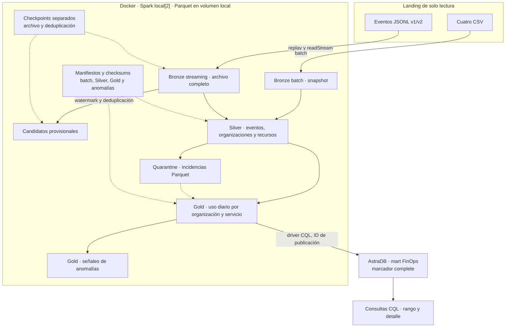

# Segunda entrega: implementación

## Arquitectura ejecutada



Se ingieren los maestros por batch y los eventos con Structured Streaming.
Silver se conforma una sola vez por corte. De ahí sale el cálculo diario que
consulta FinOps. Esto evita mantener dos vistas de serving al estilo Lambda.
Los maestros conservan sus snapshots en vez de pasar a streams, como en
Kappa. La publicación por hora y los objetivos de frescura son parte del
diseño productivo. [Diseño histórico y alternativas](primera-entrega.md#elección-del-patrón).

## 1. Entorno y configuración

Se usa Docker Desktop con contenedores Linux y Compose. El runtime usa
Python 3.11.15, Java 17 y PySpark 3.5.8. `requirements.txt` fija las
dependencias de Python con hashes. Las imágenes se fijan por digest.
El parche de Java viene de Debian. Se registra la versión ejecutada,
ya que los paquetes del sistema pueden cambiar entre builds.

Docker aísla el runtime de Windows. Su uso como entorno equivalente a
Colab se autorizó para el proyecto el 15/11/2026.
[Evidencia de funcionamiento y versiones](../evidence/environment/README.md).

### Decisión de almacenamiento

Para esta muestra se usa un volumen local persistente. Los jobs escriben
Parquet y publican por rename dentro del volumen. HDFS queda como opción
de crecimiento. El cambio de almacenamiento, la recuperación ante pérdida
del equipo y la alta disponibilidad requieren pruebas propias.

### Puesta en marcha

Se necesita Docker Desktop en modo Linux y Compose v2. Para instalarlo se
estiman 6 GB de RAM disponibles para Docker y 5 GB de disco para imágenes
y volúmenes.

1. Extraer el ZIP del campus en una carpeta que contenga `datalake/landing`.
2. Si falta `.env`, copiar `.env.example`. En `.env`, asignar a `DATASET_PATH`
   la ruta de la carpeta extraída. Usar barras `/` en Windows.
3. Crear `secrets/` en la raíz. Mantener los secretos fuera de Git.
4. Ejecutar los comandos desde la raíz del repositorio.

```sh
docker compose build runtime
docker compose run --rm --no-deps runtime python scripts/check_environment.py
```

El primer build descarga Spark y Java. La configuración sin secretos
vive en `config/runtime.toml`. El dataset se monta en solo lectura.
El volumen `lake` guarda los datos que generan los jobs. Los informes
van a una ruta separada. Python y Java se ejecutan dentro del contenedor.

Para probar serving con Cassandra local, usar `SERVING_MODE=local` en `.env`.

```sh
docker compose --profile local-serving up -d --wait --wait-timeout 360 cassandra
docker compose run --rm runtime python scripts/check_environment.py --serving
docker compose --profile local-serving stop cassandra
```

Cassandra local queda en la red de Compose sin puertos publicados al host.
El chequeo usa `system.local` para verificar la conexión CQL.

### Preparar AstraDB

1. Crear una base en [Astra](https://astra.datastax.com/) con acceso CQL.
2. Crear el keyspace desde el portal de Astra, por ejemplo `cloud_provider`.
3. Guardar el Secure Connect Bundle en `secrets/secure-connect.zip`, sin
   extraerlo. Generar un token con acceso al keyspace.
4. Completar `SERVING_MODE=astra`, `ASTRA_KEYSPACE` y `ASTRA_TOKEN` en el
   `.env` local. Mantener el token fuera del chat, los logs y los documentos.
5. Ejecutar el chequeo de Astra del [guion de demo](#guion-de-demo).

Si falta la configuración, el chequeo devuelve `pending` y sale con
código 1. Ante un fallo de conexión informa solo el tipo de error.
Revisar el modo, la base, los permisos, el bundle y la red. La salida de
`docker compose config` puede incluir credenciales. Mantenerla en privado.

El chequeo registra versiones y hashes del dataset. También escribe y
relee un Parquet sintético. Con `--serving` ejecuta una consulta CQL de
lectura. La [sección 6](#6-serving-en-astradb-y-consultas-cql) verifica
la carga del mart. El comando `stop` conserva el volumen de Cassandra.

[Documentación de Spark 3.5.8](https://spark.apache.org/docs/3.5.8/).

## 2. Contratos e ingesta batch a Bronze

Se ingieren `customers_orgs`, `users`, `billing_monthly` y `resources`.
Los contratos viven en `src/cloud_analytics/contracts.py`. Los campos
que no figuran en la tabla quedan como `string`.

| Fuente y clave | Tipos explícitos |
| --- | --- |
| customers_orgs: org_id | is_enterprise: boolean; signup_date: date; nps_score: decimal(38,12) |
| users: user_id | active: boolean; created_at y last_login: date |
| billing_monthly: invoice_id | month: date; subtotal, credits, taxes y exchange_rate_to_usd: decimal(38,12) |
| resources: resource_id | created_at: date |

Las fechas usan `YYYY-MM-DD`, incluido el mes de facturación. Los booleanos
admiten true/false en cualquier combinación de mayúsculas. Los decimales
admiten signo y hasta 12 cifras fraccionarias. Los formatos inválidos y el
overflow quedan nulos y se registran como errores. Los campos vacíos
quedan nulos. NPS conserva el valor decimal de origen.

### Lectura y trazabilidad

Antes de leer, se comprueba que el archivo tenga datos, el encabezado
esperado y la cantidad de columnas correcta en cada fila. Spark lee las
columnas como texto y luego las convierte. El lector admite comas, comillas
escapadas y saltos de línea dentro de campos entrecomillados. `raw` conserva
los campos que entrega el lector. El archivo original queda en Landing.

Cada registro añade `ingest_ts` UTC, `ingest_date`, `source_file`, `source_hash`,
`batch_id`, `contract_version`, `source_record_hash`, `source_occurrences`,
`key_variants` y `parse_errors`. El hash de registro identifica los campos
que interpretó el lector. El hash de archivo permite volver al original.

Se conserva una fila por registro idéntico y se cuenta el total de copias en
`source_occurrences`. Las variantes de una misma clave quedan marcadas como
`conflicting_key`. A las claves ausentes se les asigna `missing_key`. Los
errores de tipos se registran por campo. Bronze conserva los datos de origen.
Silver aplica las reglas de negocio.

### Publicación y reejecución

```text
/lake/bronze/batch_id=<id>/
  manifest.json
  customers_orgs/ingest_date=YYYY-MM-DD/*.parquet
  users/ingest_date=YYYY-MM-DD/*.parquet
  billing_monthly/ingest_date=YYYY-MM-DD/*.parquet
  resources/ingest_date=YYYY-MM-DD/*.parquet
```

Las cuatro fuentes se publican juntas. El manifiesto registra las entradas,
esquemas, conteos, errores y hashes de salida. Leer cada fuente desde
la ruta que figura en el manifiesto.

El ID depende de los hashes de entrada, el contrato, el código y la versión
de Spark. Al repetir la ingesta se verifican los archivos y se devuelve
`reused`. Se conserva la fecha de ingesta original. Un cambio de entradas
genera un snapshot separado. Silver recibe el ID elegido.

Se escribe en `.bronze-staging`. Antes del rename se relee el Parquet y
se verifica que las entradas sigan iguales. Un lock evita escrituras
concurrentes. Un fallo controlado limpia el staging. Una terminación
forzada puede dejar archivos sin publicar. Si cambió un lote publicado,
el job lo rechaza. Este mecanismo usa el volumen local de Linux.

Se escribe un Parquet por fuente y fecha de ingesta. La revisión inicial
lee los archivos en secuencia. Spark ejecuta en `local[2]`.

### Ejecución y verificación

Ejecutar desde la raíz con la configuración de la sección 1.

```sh
docker compose run --rm --no-deps runtime python scripts/ingest_batch.py --report-name revision
```

Ante un fallo se devuelve código 1 y un diagnóstico sin datos de origen.
Un error de encabezado o estructura bloquea el lote completo.
[Conteos y reejecución batch](../evidence/batch/README.md).

## 3. Streaming de eventos a Bronze

Se usan dos consultas de Structured Streaming con checkpoints separados.
La primera archiva el JSONL completo. La segunda lee ese archivo, aplica
el watermark y deduplica por `event_id`. Ambas procesan en micro-lotes
con `availableNow` y terminan al agotar la entrada. Cada reintento retoma
su checkpoint. La latencia continua de 60 segundos sigue pendiente.

### Contrato y reproducción

`usage_contract.py` reúne los esquemas v1 y v2. Se guarda la línea en
`raw_json` y se interpreta con `from_json`. Costos, consumo y carbono usan
decimal(38,12). Tokens usa bigint, versión usa int y la hora usa timestamp
UTC. Se aceptan números como texto y notación científica si respetan la
escala. Los campos v2 ausentes quedan nulos. `parse_errors` registra JSON
malformado, tiempos inválidos y versiones desconocidas.

Cada evento registra `stream_id`, contrato, archivo, SHA-256 original,
hash de línea, `ingest_ts` e `ingest_date`. Los IDs de micro-lote y el progreso
quedan en los checkpoints, los metadatos del sink y la evidencia de la
consulta.

`replay_usage.py` verifica los hashes y renombra las copias completas al
directorio observado. Conserva los originales y el orden de los eventos.
`--interval` fija la pausa entre archivos y `--limit` su cantidad. El
reintento verifica las copias existentes. Un lock evita que el replay y
el consumidor cambien el corte al mismo tiempo.

### Watermark, conflictos y tardanza

Se usan 60 días de watermark por el desorden temporal de la muestra.
`config/runtime.toml` también fija `max_files_per_trigger=20`.
`dropDuplicatesWithinWatermark` deduplica dentro del margen que permite
el estado retenido.

Se archiva Bronze completo antes de deduplicar. El archivo conserva
duplicados, conflictos y eventos fuera del margen. Para deduplicar se
exigen identidad, tiempo y versión válidos.

Se comparan las variantes por `event_id` después de ambas consultas.
Se registran los IDs en conflicto y se excluyen del conteo de candidatos
sin conflicto. Un candidato puede salir antes de que aparezca otra
variante. Silver parte del archivo completo y aplica sus reglas por medida.

`deferred` registra contribuciones elegibles que quedaron sin equivalente
en los candidatos. Incluye tardíos y variantes descartadas. Los descartes
por watermark se miden aparte en Spark. Silver reconstruye desde el corte
retenido y publica quarantine. El recálculo incremental por grupo queda pendiente.

### Estado, reinicio y ejecución

Rutas del volumen.

```text
/lake/streams/<stream-id>/inbox/
/lake/streams/<stream-id>/checkpoints/{archive,dedup}/
/lake/streams/<stream-id>/audits/<revision>/{conflicts,deferred}/
/lake/bronze/usage_events/stream_id=<stream-id>/ingest_date=.../
/lake/bronze/usage_candidates/stream_id=<stream-id>/ingest_date=.../
```

Leer cada sink desde su raíz para respetar `_spark_metadata`. La auditoría
publica una revisión y `audit-head.json`. Al empezar otra corrida, se
invalida la referencia anterior. Los temporales quedan fuera de Git.

Se reutiliza una sesión si conserva sus checkpoints, parser, watermark,
versión de Spark y particiones de estado. Para reprocesar, usar un
`--stream-id` nuevo en ambos comandos y conservar los checkpoints
anteriores. Usar un solo corte de cada histórico. La sesión verificada
usa `usage-v1`.

```sh
docker compose run --rm --no-deps runtime python scripts/replay_usage.py --stream-id usage-v1
docker compose run --rm --no-deps runtime python scripts/ingest_stream.py --stream-id usage-v1 --report-name revision
```

Las pruebas sintéticas cubren duplicados, tardanza, conflictos y fallos.
El informe conserva hasta 1000 registros de progreso de cada consulta
por invocación. [Corridas de streaming](../evidence/streaming/README.md).

[Structured Streaming 3.5.8](https://spark.apache.org/docs/3.5.8/structured-streaming-programming-guide.html)
y [deduplicación con watermark](https://spark.apache.org/docs/3.5.8/api/python/reference/pyspark.sql/api/pyspark.sql.DataFrame.dropDuplicatesWithinWatermark.html).

## 4. Silver, calidad y quarantine

### Selección de entradas

Usar el `manifest.batch_id` de la ingesta batch y el `cut_id` de
`--inspect-cut`. Se leen los maestros de ese snapshot y el archivo
completo de la sesión. Spark selecciona los archivos comprometidos con
`_spark_metadata`. El corte fija la sesión, las rutas, los tamaños y los
SHA-256. Se bloquea al consumidor Bronze durante la lectura. Si el archivo
avanzó entre los dos comandos, Silver rechaza el corte anterior.

```sh
docker compose run --rm runtime python scripts/build_silver.py --stream-id usage-v1 --inspect-cut
docker compose run --rm runtime python scripts/build_silver.py --stream-id usage-v1 --batch-id <batch_id> --archive-cut <cut_id> --report-name revision
```

### Contrato y reglas

Se usan los tipos v1/v2 de Bronze y fechas UTC. Se recortan las claves y
las categorías pasan a minúsculas. Organizaciones y recursos se conforman
a una fila por clave del snapshot. El linaje conserva la multiplicidad
de variantes equivalentes. La vigencia de las dimensiones corresponde al
snapshot. Una clave con datos inválidos o contradictorios queda en quarantine.

Se exige ID, hora válida, esquema conocido y referencias válidas.
Organización, servicio y región deben coincidir con el recurso. Una variante
inválida o un desacuerdo en fecha o dimensiones bloquean el ID completo.
Si coinciden, se comparan las medidas por separado. Cuando falla un cast,
se compara el dato de origen. Se publica una fila por ID con linaje y las
versiones del esquema en `schema_versions`. Se puede completar un campo
opcional si las demás copias aportan un único valor.

| Medida | Validación |
| --- | --- |
| Costo | Decimal presente y mayor o igual a cero. La consigna admite `>= -0.01`; se separan todos los negativos porque la fuente carece de información para distinguir ajustes autorizados. Los importes positivos altos siguen utilizables. |
| Consumo | Valor presente y no negativo, con pareja exacta `requests/count`, `cpu_hours/hours` o `storage_gb_hours/gb_hours`. Las tres columnas derivadas aportan valor sólo para su métrica y unidad válidas. |
| Carbono | Decimal no negativo cuando se reporta. |
| Tokens | Entero no negativo de servicio `genai` cuando se reporta. |

Cada medida queda `valid`, `quarantined` o `absent`. Una contradicción
bloquea la medida y sus variantes quedan en quarantine. Las medidas
ausentes o bloqueadas quedan nulas. Si la identidad es válida, se conserva
la fila para medir cobertura. El costo incremental viene del evento.
Revenue viene de facturación.

Quarantine guarda una incidencia por fila Bronze y ámbito. Los ámbitos son
`master`, `event`, `cost`, `usage`, `carbon` y `tokens`. Se registra el motivo,
la clave, el archivo, los hashes, el contrato, la fecha de ingesta, la sesión
o el lote y el dato original. Un ID Silver puede tener varias incidencias.
Si se bloquea el evento completo, cada variante va al ámbito `event`.
El detalle queda en el volumen local del proyecto. Se versionan métricas,
motivos y metadatos técnicos.

### Publicación y reejecución

```text
/lake/silver/publication_id=<id>/
  manifest.json
  customers_orgs/
  resources/
  usage_events/event_date=YYYY-MM-DD/
  quarantine/ingest_date=YYYY-MM-DD/
```

Se particionan los eventos por día UTC y quarantine por día de ingesta.
Los maestros se leen completos. Las tablas vacías conservan el esquema.
Se verifican conteos, tipos y checksums. Un rename publica las cuatro
tablas juntas. Si falla antes, el reintento escribe en otro temporal. Una
interrupción abrupta puede dejar temporales sin publicar. Con la misma
entrada y código se verifica y reutiliza el ID. Para reconstruir un corte
anterior se necesita su archivo Bronze original.

[Evidencia y pruebas de Silver](../evidence/silver/README.md).

## 5A. Agregaciones y mart Gold

`org_daily_usage_by_service` tiene una fila por `(org_id, event_date, service)`
con fecha UTC. Se verifica una publicación Silver. Cada fila registra su
`silver_publication_id`.

```sh
docker compose run --rm runtime python scripts/build_gold.py --silver-publication-id <publication_id> --report-name revision
```

Se suman solo aportes válidos de `daily_cost_usd`, `requests`, `cpu_hours`,
`storage_gb_hours`, `carbon_kg` y `genai_tokens`. Importes y consumos usan
decimal(38,12). Tokens pasa a decimal(38,0) antes de sumar. Una suma sin
aportes válidos queda nula. Se conserva un cero válido. Si desborda una
suma de grupo o de conciliación, se aborta la publicación.

Cada medida tiene un struct `<medida>_coverage` con `eligible`, `valid`,
`quarantined`, `absent`, `valid_fraction` y `state`. La fracción divide
los válidos por los elegibles de Silver. Con denominador cero queda nula.

| Medida | Población elegible |
| --- | --- |
| Costo y carbono | Todos los eventos Silver del grupo. Carbono sin reporte cuenta como ausente. |
| Requests, CPU y almacenamiento | Eventos de la métrica correspondiente. Para consumo en quarantine se usa la declaración original si todas las variantes coinciden en una métrica conocida. Cada ID cuenta una vez. |
| Tokens | Eventos GenAI y reportes bloqueados fuera de GenAI. |

La cobertura se calcula sobre el corte observado. `complete` indica que
hay aportes válidos y cobertura completa. `partial` indica que también hay
faltantes o bloqueos. Si hay bloqueos sin aportes válidos, el estado es
`unavailable`. Si todos los aportes elegibles están ausentes, queda
`absent`. Si el denominador es cero y no hay bloqueos, queda `not_applicable`.
`unassigned_usage_events` cuenta métricas ambiguas o desconocidas. Estos
casos afectan la cobertura de las tres medidas de consumo y quedan fuera
de sus denominadores.

Si Silver confirma la ubicación de un evento excluido, se afecta la
cobertura de todas las medidas del grupo. Se exige fecha UTC interpretable
y que organización y servicio coincidan con el recurso. Se cuentan IDs
distintos por grupo o huellas si falta el ID. Un mismo ID puede afectar
varias claves. Los grupos que solo aparecen en quarantine quedan con
sumas nulas. El manifiesto registra las variantes sin ubicación, incluso
si otras variantes del mismo ID sí se pudieron ubicar.

El mart vive en
`/lake/gold/publication_id=<id>/org_daily_usage_by_service/event_date=YYYY-MM-DD/`.
Se particiona por fecha. Antes del rename, se relee el Parquet y se
concilian los totales y conteos válidos con Silver. El manifiesto vincula
el SHA-256 de Silver, el código y los checksums de Gold. Con el mismo
origen y código se verifica y reutiliza la salida.
[Evidencia de Gold](../evidence/gold/README.md).

## 5B. Análisis estadístico de picos de costo

`cost_anomaly_mart` conserva una fila por organización, fecha UTC y servicio.
Se elige una publicación Gold y se verifican su manifiesto y checksums.

```sh
docker compose run --rm runtime python scripts/build_cost_anomalies.py --gold-publication-id <publication_id> --window-days 28 --min-observations 7 --score-threshold 3.5
```

Para el día D se usan costos completos de la misma organización y servicio
entre D−28 y D−1, inclusive. El mínimo es siete observaciones válidas.
Los ceros cuentan. Los días sin fila quedan fuera. La ventana, el mínimo
y el umbral se pueden ajustar por comando.

Se usa el score z modificado unilateral. Se toma la mediana histórica y
se calcula la MAD, la mediana de las desviaciones absolutas respecto de
esa mediana. Se marca un pico si `0.6745 × (costo − mediana) / MAD` supera
3,5. El umbral sobre el costo es `mediana + 3.5 × MAD / 0.6745`. La mediana
y la MAD reducen la influencia de extremos en series cortas. La muestra
carece de etiquetas para calibrar el umbral.
[Guía de detección de valores atípicos de NIST](https://www.itl.nist.gov/div898/handbook/eda/section3/eda35h.htm).

| Motivo de fila no evaluable | Criterio |
| --- | --- |
| `incomplete_cost_coverage` | El costo actual tiene un estado de cobertura distinto de `complete`. |
| `insufficient_history` | La ventana tiene menos observaciones elegibles que el mínimo. |
| `zero_historical_mad` | La dispersión robusta es cero. Se conserva la referencia y el score queda nulo. |
| `unlocated_gold_exclusions` o `gold_exclusion_metadata_unverified` | Se bloquea todo el corte si existen exclusiones sin ubicación o si faltan metadatos concluyentes. No es posible delimitar qué series afectan. |
| `gold_coverage_state_unknown` o `gold_complete_cost_invalid` | El estado es desconocido o un costo declarado completo es nulo o negativo. |

Si la fila queda sin evaluar, `is_anomaly` queda nulo. Si se evalúa, se
registra el indicador junto con el motivo, la mediana, la MAD, el umbral
y el score. `history_observations` cuenta costos previos elegibles y queda
en cero si se bloquea el corte. El costo observado y la comparación usan
decimales. Los diagnósticos se guardan como `double`. El mart guarda el
ID Gold, el método y sus parámetros.

Se publica por rename en
`/lake/gold/anomalies/publication_id=<id>/cost_anomaly_mart/`. Se particiona
por fecha. El ID fija la entrada, el código y los parámetros. Al reejecutar
se verifica y reutiliza la publicación.

La regla se calcula sobre el historial de cada fila y no requiere
entrenamiento. Se señalan picos para revisión y se conserva el costo en
Gold. Para medir precisión y recall se necesitan etiquetas. La ventana
no ajusta por estacionalidad ni cambios de nivel.
[Evidencia del análisis estadístico](../evidence/anomalies/README.md).

## 6. Serving en AstraDB y consultas CQL

La consigna admite una carga desde Spark con un driver. Exige una tabla
orientada a consultas y dos consultas con resultados (§§4.4 y 6.2).
Se usa el driver Python del runtime y el keyspace de la sección 1. Se
necesitan permisos CQL para leer, escribir y crear tablas. El bundle se
monta en solo lectura. El driver extrae su contenido a un temporal.
[Esquema del mart y su tabla de control](../config/finops-serving.cql).

### Consultas y grano

La clave es `PRIMARY KEY ((publication_id, org_id, service, usage_month), event_date)`.
La publicación fija el snapshot y el par organización–servicio fija la
serie. `usage_month` es el primer día del mes UTC y limita cada partición
a 31 filas. La clave de clustering permite buscar por rango o por fecha.
Si el rango cruza meses, se consulta cada partición y se devuelven las
filas en orden.

| Consulta FinOps | Predicados CQL |
| --- | --- |
| Costo y consumo diario de una organización y servicio en un rango inclusivo | Clave de partición completa y `event_date >= ? AND event_date <= ?` |
| Detalle de una fecha de la misma serie, incluidas las coberturas | Clave de partición completa y `event_date = ?` |

Las consultas devuelven las medidas como `decimal`, incluidos ceros y
nulos. La cobertura conserva el orden `eligible`, `valid`, `quarantined`,
`absent`, `valid_fraction` y `state`. También se devuelven los IDs de Gold
y Silver y los conteos del grupo.

### Carga y estado

Antes de conectarse, Spark valida la identidad, los checksums, el conteo
y el grano de Gold. Reparte y ordena las filas por clave. Con
`toLocalIterator()` el driver recibe una partición a la vez. Las
sentencias preparadas usan lotes de hasta 64 filas y un máximo
de 16 operaciones CQL en paralelo.

Una inserción condicional en `finops_publications` vincula el ID al hash
del manifiesto Gold, al esquema CQL y al conteo esperado. La carga queda
`loading`. Se releen en Astra las particiones declaradas en Gold y se
comparan filas, valores y coberturas. Otra escritura condicional cambia el estado a `complete`.
Una carga interrumpida puede dejar filas en Astra. El comando de consulta
exige el estado `complete`, la identidad y el conteo. Aplicar la misma
verificación al consultar con CQL directo.

Un reintento usa las mismas claves para los upserts. Si la carga ya está
completa, se repite la verificación sin reescribir el mart. Se detectan
filas adicionales en las particiones de la publicación de origen. Esta
verificación supone que solo escribe el cargador. Cada consulta fija
un ID y puede apuntar a una publicación anterior.

```sh
docker compose run --rm --no-deps runtime python scripts/serve_finops.py load --gold-publication-id <publication_id> --report-name revision
docker compose run --rm --no-deps runtime python scripts/serve_finops.py query --gold-publication-id <publication_id> --org-id <org_id> --service <service> --start <yyyy-mm-dd> --end <yyyy-mm-dd> --detail <yyyy-mm-dd> --report-name revision-query
```

[Comandos, CQL y evidencia de serving](../evidence/serving/README.md).
[Guía del driver Python para Astra](https://docs.datastax.com/en/astra-db-serverless/drivers/python-driver.html).

## 7. Validación integrada, idempotencia y recuperación

El comando encadena el lote batch y el corte Bronze con Silver, Gold y
anomalías. El mismo ID Gold se usa para cargar Astra y verificar las dos
consultas. Cada corrida usa su sesión de streaming y el dataset de solo
lectura. Los informes y el Lake quedan en `/lake/integration/<validation-id>/`.

Para empezar, elegir `--validation-id` y nombres de informe nuevos.
Para reintentar, conservar el ID y los parámetros de consulta.
`--compare-to` compara IDs de publicación y consultas streaming, hashes
de manifiesto, conteos, conciliación y resultados CQL. Exige reutilizar
las publicaciones y registrar cero archivos nuevos, filas reingeridas
y upserts. Usar `--org-id`, `--service`, `--start`, `--end` y `--detail`
para seleccionar la consulta. [Guion de demo](#guion-de-demo).

El ID batch depende de los hashes de origen y del contrato, con el mismo
código y entorno. Al partir de cero pueden cambiar las marcas de ingesta,
los IDs de consultas y los archivos Parquet. El nuevo corte puede cambiar
los IDs de Silver, Gold y anomalías. Con las mismas entradas y parámetros
se esperan los mismos granos, medidas, coberturas y decisiones. El reintento
del mismo corte conserva IDs y checkpoints. Sus informes y auditorías
pueden ser nuevos.

La prueba opcional de Astra usa un ID Gold nuevo. Interrumpe la carga
tras confirmar una fila, comprueba el estado `loading` y exige que el
comando de consulta devuelva `publication_not_ready`. Luego completa y
verifica la carga. Si se interrumpe la prueba, reintentar con el mismo ID
de validación y un nombre de informe nuevo. Omitir `--exercise-serving-recovery`.
El ID de prueba queda separado en las tablas de Astra.

Se probó la recuperación de streaming con los mismos checkpoints.
En Silver se probó un fallo antes del rename. La corrida real verifica
el linaje, la unicidad, la conciliación de seis medidas y la cobertura de
los costos en anomalías. También compara las particiones declaradas en
Astra y ambas consultas con Gold. El informe registra 43.200 eventos
Silver y 11.050 filas Gold y Astra. El reintento conservó los resultados
sin filas nuevas en streaming ni upserts.
[Resultados y comandos](../evidence/integration/README.md).

## 8. Cierre del segundo parcial

### Matriz de cumplimiento

La matriz cubre los §§6.2–6.4 y el checklist §9.2 de la consigna del ITBA
2C 2026 (pp. 9–10 y 15). El [backlog](#backlog-para-la-entrega-final) cubre
los §§7.2–7.6 y §9.3 de la final (pp. 11–12 y 15).

| Requisito del segundo parcial | Implementación | Evidencia | Estado |
| --- | --- | --- | --- |
| Correcciones priorizadas y arquitectura coherente | Feedback registrado, retención y roles definidos. Diagrama actualizado al volumen local y al flujo FinOps. | [Correcciones históricas](primera-entrega.md#correcciones-posteriores-al-feedback), [diagrama](#arquitectura-ejecutada) | Documentado |
| Batch a Bronze de al menos tres fuentes | Cuatro CSV a Parquet particionado con esquema explícito, `ingest_ts`, `source_file` y deduplicación de filas idénticas. | [Conciliación batch](../evidence/batch/README.md) | Verificado |
| Streaming a Bronze | Esquema v1/v2, watermark, deduplicación por `event_id`, archivo completo para datos tardíos y dos checkpoints. | [Corridas y casos tardíos](../evidence/streaming/README.md) | Verificado |
| Silver con eventos, maestro y features | Conformado y joins de organizaciones y recursos. Silver prepara las contribuciones tipificadas y Gold agrega seis medidas. | [Silver](../evidence/silver/README.md), [conciliación de medidas](../evidence/gold/README.md#conciliación) | Verificado |
| Calidad y quarantine con muestras | Identidad, unidad cuando hay valor y regla alternativa de costo. Se aíslan todos los negativos pendientes de validación y se señalan picos sobre costos diarios. | [Reglas](#contrato-y-reglas), [muestras sin identificadores](../evidence/silver/quarantine-samples.json) | Verificado con regla alternativa justificada |
| Mart diario Gold | `org_daily_usage_by_service` por organización, día UTC y servicio, con cobertura. | [Gold](../evidence/gold/checks.json) | Verificado |
| Keyspace, tabla query-first, carga Spark y dos consultas | Keyspace Astra configurado, esquema CQL versionado, carga verificada y consultas de rango y fecha exacta. | [CQL y resultados](../evidence/serving/queries.json), [carga](../evidence/serving/first.json) | Verificado en Astra |
| Componente analítico o ML | Score estadístico unilateral con mediana y MAD, sin entrenamiento ni etiquetas. | [Método](#5b-análisis-estadístico-de-picos-de-costo), [resultados](../evidence/anomalies/README.md) | Analítica verificada: la consigna admite analítica o ML (§6.2) y menciona MAD para anomalías (§4.4) |
| Idempotencia, pruebas, logs y reproducción | Quickstart, pruebas sintéticas, ejecución real aislada y reintento sin duplicados. | [Quickstart](../README.md#quickstart), [ejecución](../evidence/integration/first.json), [reintento](../evidence/integration/repeat.json), [30 pruebas](../evidence/integration/tests.log) | Verificado en el entorno Docker configurado |
| Gobierno preliminar | Contratos, manifiestos, reglas de acceso a secretos, trazabilidad y responsable de limpieza. | [Política de operación](primera-entrega.md#retención-y-operación), [configuración](#1-entorno-y-configuración) | Documentado. Falta probar operación final |
| Backlog y decisiones técnicas | Prioridades y criterios de aceptación, decisiones de patrón, particiones, claves CQL y umbral. | [Arquitectura](#arquitectura-ejecutada), [backlog](#backlog-para-la-entrega-final) | Documentado |

### Guion de demo

**Demo rápida con publicaciones existentes.** Verificar el entorno y la
conexión de lectura a Astra. El informe del chequeo queda en un temporal.
Se conserva el informe versionado.

```sh
docker compose run --rm --no-deps -e SERVING_MODE=astra runtime sh -c 'sed "s|/workspace/evidence|/tmp/demo-evidence|" "$APP_CONFIG" > /tmp/demo.toml && APP_CONFIG=/tmp/demo.toml python scripts/check_environment.py --serving'
```

1. Seguir los IDs de Bronze a Gold. Mostrar 43.200 eventos Silver y
   11.050 claves Gold. [Informe integrado](../evidence/integration/first.json).
2. Mostrar un caso de unidad ausente. El consumo queda nulo y el costo
   sigue disponible. [Muestras de quarantine](../evidence/silver/quarantine-samples.json).
3. Ejecutar las dos consultas del punto 6. Se requiere su Parquet local
   y el estado `complete` en Astra. Si existe `demo-query`, usar otro
   nombre de informe.

```sh
docker compose run --rm --no-deps runtime python scripts/serve_finops.py query --gold-publication-id ad9dcfe3db7eda46accbaa3c8a384b11c44589472ae8f13fd91d6c9efa931d52 --org-id org_he7ur23g --service compute --start 2025-07-29 --end 2025-08-04 --detail 2025-08-03 --report-name demo-query
```

4. Abrir `evidence/serving/demo-query.json`. Mostrar siete filas de rango.
   El detalle tiene 40,4290 USD de costo parcial, con cinco aportes válidos
   de seis. [Resultado registrado](../evidence/serving/queries.json).
5. Mostrar 9.003 filas evaluadas, 243 señales y 2.047 sin evaluar. De estas,
   213 tienen costo parcial y 1.834 carecen de historial suficiente.
   [Informe de anomalías](../evidence/anomalies/first.json).
6. Comparar IDs y resultados. Mostrar cero filas nuevas y cero upserts.
   Explicar el reinicio desde checkpoints, el fallo antes del rename
   y el rechazo de lecturas en `loading`. [Primera corrida](../evidence/integration/first.json),
   [reintento](../evidence/integration/repeat.json) y
   [pruebas de recuperación](../evidence/integration/README.md#recuperación-verificada).

Si el volumen o Astra no están disponibles, usar los informes versionados
y explicar qué parte de la demo en vivo queda bloqueada.

**Corrida completa desde cero.** Completar la [puesta en marcha](#puesta-en-marcha)
y [configurar Astra](#preparar-astradb). Elegir un ID y nombres de informe
libres. El primer comando publica un Gold nuevo en Astra. El segundo
repite la corrida y verifica la reutilización.

```sh
docker compose run --rm --no-deps runtime python scripts/validate_integration.py --validation-id cierre-01 --report-name cierre-first
docker compose run --rm --no-deps runtime python scripts/validate_integration.py --validation-id cierre-01 --report-name cierre-repeat --compare-to cierre-first
docker compose run --rm --no-deps runtime python -W ignore::ResourceWarning -m unittest discover -s tests -v
```

La suite sintética cubre interrupciones en streaming y Silver. Para
probar un fallo real en Astra, agregar `--exercise-serving-recovery` solo
al primer comando de un corte nuevo.

### Muestra reducida y reinicio seguro

`demo_sample.py` genera datos sintéticos del 24/07 al 04/08/2025. La
muestra usa cuatro CSV compatibles con los contratos de ingesta y dos
JSONL v1/v2 con referencias a organizaciones y recursos. El manifiesto guarda el origen, los SHA-256
y los casos de demo. Con el mismo ID, se verifican y reutilizan los
archivos. Si falta el ZIP del campus, usar `DATASET_PATH=./data` en
`.env` para el montaje de Compose. El validador lee su propia muestra.

La serie `demo-org`/compute incluye un pico el 01/08, días con historial
insuficiente, un costo cero y dos incidencias: un costo negativo y una
unidad ausente. El rango del
30/07 al 04/08 cruza meses. El detalle del 02/08 tiene costo parcial.
El manifiesto fija la consulta por defecto. Se puede cambiar con
`--org-id`, `--service`, `--start`, `--end` y `--detail`. Para reintentar,
conservar los mismos parámetros.

```sh
docker compose run --rm --no-deps runtime python scripts/demo_sample.py generate --demo-id finops-demo
docker compose run --rm --no-deps runtime python scripts/validate_integration.py --demo-id finops-demo --report-name first
docker compose run --rm --no-deps runtime python scripts/validate_integration.py --demo-id finops-demo --report-name repeat --compare-to first
```

El reintento conserva IDs, checkpoints y publicaciones. Si la primera
corrida se interrumpe, elegir un informe nuevo y omitir `--compare-to`
hasta completar una corrida. Para empezar otra demo, usar un ID nuevo.
Los informes compactos quedan en `/lake/demos/<id>/reports`. La
configuración y los informes de cada job quedan bajo `work/runs`.
Las corridas con el dataset completo conservan sus rutas.

Antes de reiniciar el mismo ID, revisar el plan. El comando valida la ruta
absoluta bajo `/lake/demos/<id>/work`, el dueño y el manifiesto. Rechaza
enlaces simbólicos, montajes internos y salidas del área administrada.
La generación, la ejecución y la limpieza comparten un lock por demo.

```sh
docker compose run --rm --no-deps runtime python scripts/demo_sample.py clean --demo-id finops-demo --dry-run
docker compose run --rm --no-deps runtime python scripts/demo_sample.py clean --demo-id finops-demo --apply
docker compose run --rm --no-deps runtime python scripts/validate_integration.py --demo-id finops-demo --report-name restart
```

`--apply` retira el Lake, los checkpoints y los informes detallados de
esa demo. Conserva la muestra, el manifiesto y los informes compactos.
También quedan intactos Landing, los secretos y las otras ejecuciones.
Si se interrumpe la limpieza local, repetir el plan y la aplicación.
Astra conserva las filas y los marcadores, incluidos los `loading`.
Cada arranque limpio publica un ID nuevo. El informe anterior conserva
el suyo. [Evidencia de la muestra y las pruebas](../evidence/demo/README.md).

Se tomaron la fecha fija y el ensayo de dos corridas del commit
`e9836e8d2fbb0c3a25c239b8565393ee4672fef6` de `bigdata`. Se consultaron
`scripts/bootstrap_sample_landing.py`, `scripts/run_mvp.py`,
`README.md` y `docs/segundo_parcial/idempotencia.md` con `git show`.
El código de la demo usa los contratos y controles de este proyecto.

### Backlog para la entrega final

La final exige cinco consultas desde Cassandra/AstraDB. La serie diaria
FinOps cubre la primera. El detalle puntual completa el mínimo del
segundo parcial. Quedan cuatro consultas, sus artefactos y la defensa.
El orden propuesto se revisa con la devolución de la cátedra.
[Evidencia de la consulta disponible](../evidence/serving/README.md).

| Prioridad | Tarea | Dependencias | Criterio de aceptación | Responsable |
| --- | --- | --- | --- | --- |
| Obligatorio 1 | Consolidar la evidencia analítica para la final | Detector estadístico y publicaciones finales de Gold | Revalidar las señales sobre el corte final y documentar cobertura, resultados y limitaciones, sin inferir precisión ni recall en ausencia de etiquetas. | Francisco Sendot |
| Obligatorio 2 | Top-N de servicios por costo de los últimos 14 días | FinOps diario, ventana calendario, regla de elegibilidad ante cobertura parcial y esquema query-first | Resultado reproducible en Astra para una organización y fecha, cotejado con Gold, con orden y casos parciales explicados. | Santos Galarraga |
| Obligatorio 3 | Tickets críticos, tasa de SLA y mart de Soporte | Ingesta de `support_tickets.csv`, severidad, indicador SLA y cobertura de CSAT | Consulta diaria de 30 días en Astra con conteos y tasa conciliados y nulos preservados. | Francisco Sendot |
| Obligatorio 4 | Revenue mensual en USD con créditos, impuestos y FX | Billing Bronze, criterios para créditos vacíos, montos negativos y tipos de cambio | Mart organización–mes y consulta en Astra con conversión trazable, parciales e importes conciliados. | Santos Galarraga |
| Obligatorio 5 | Tokens GenAI y costo diario estimado | Contribuciones GenAI de Silver, regla explícita de costo y cobertura | Mart organización–día y consulta verificable en Astra; documentar cómo se obtiene el costo y qué aportes faltan. | Francisco Sendot |
| Obligatorio 6 | Operación, seguridad y cierre de evidencias | Marts y consultas finales, política de retención, configuración externalizada | Extender la verificación de reinicio y limpieza local de demo al alcance final, definir la retención de publicaciones Astra y registrar tamaños, conteos y errores sin exponer secretos. | Santos Galarraga |
| Obligatorio 7 | Reproducción y defensa de la final | Cinco consultas, diccionario de datos, arquitectura final y resultados integrados | Validar el Quickstart desde un entorno limpio, ampliar la muestra reducida a los marts finales, conservar CQL y salidas de las cinco consultas, y completar presentación, video y defensa remota. | Francisco Sendot (documentación y presentación) y Santos Galarraga (reproducción y demo). Defensa compartida. |
| Deseable | Medir desempeño y ensayar la demo reducida | Integración final, casos de cobertura y criterio de medición | Repetir la demo con tiempos y recursos medidos. Revisar el objetivo operativo con mediciones de frescura y backlog. | Santos Galarraga (medición) y Francisco Sendot (ensayo de la demo) |
| Fuera de alcance del MVP final propuesto | Migrar a HDFS o activar serving operativo por hora, rankings D/D−1 o dashboards adicionales | Revisión de alcance, demanda y pruebas de escala | Mantenerlos como propuestas hasta justificar su incorporación sin comprometer los requisitos obligatorios. | Francisco Sendot y Santos Galarraga (revisión de alcance) |

El reparto para la final es una propuesta. Parte de los roles del
[plan inicial](primera-entrega.md#esfuerzo-y-próximos-pasos) y la
[política de retención](primera-entrega.md#retención-y-operación).
Se validaron cortes finitos en Spark local. Quedan fuera de esta prueba la
alta disponibilidad, la frescura continua, la limpieza automática y el
desempeño distribuido.
